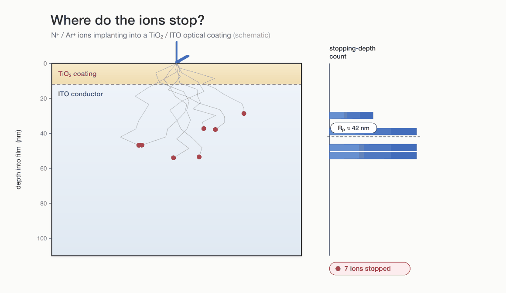
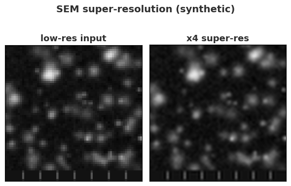
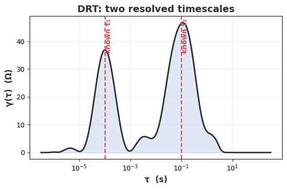
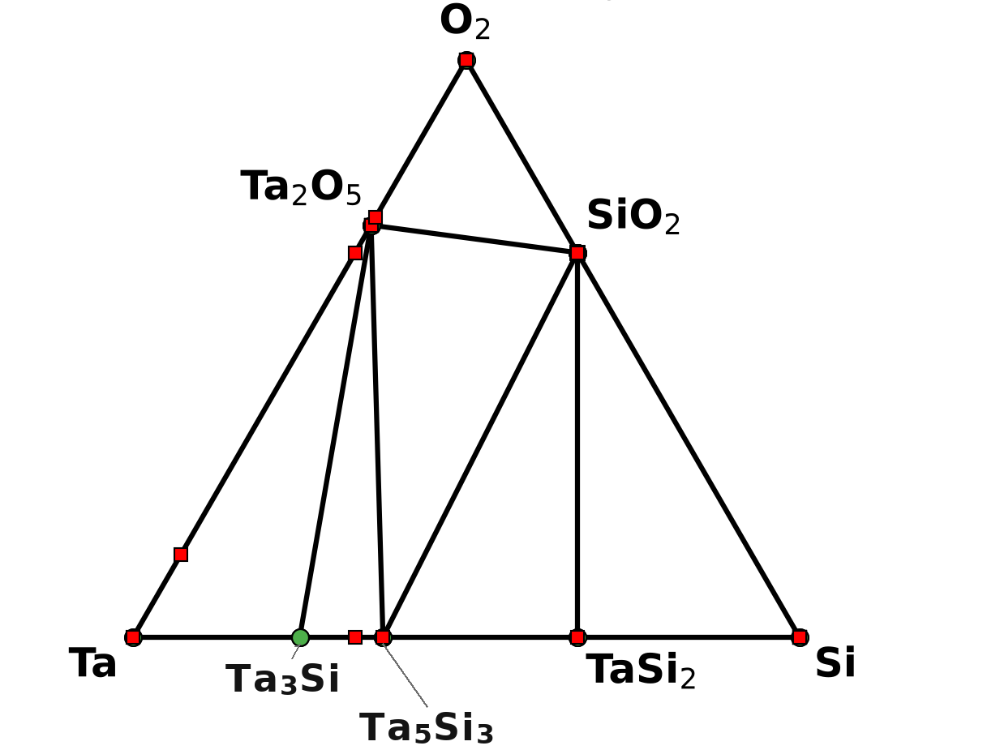
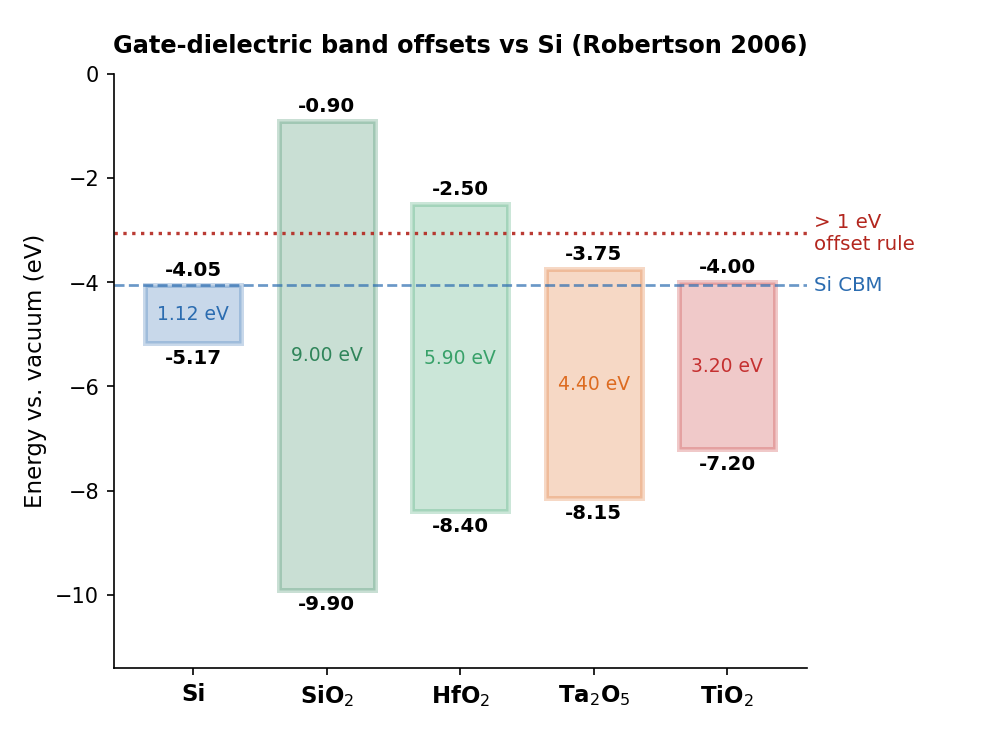
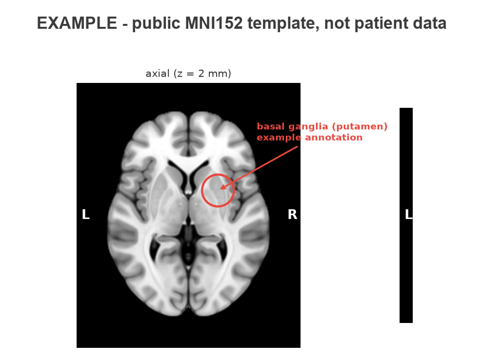
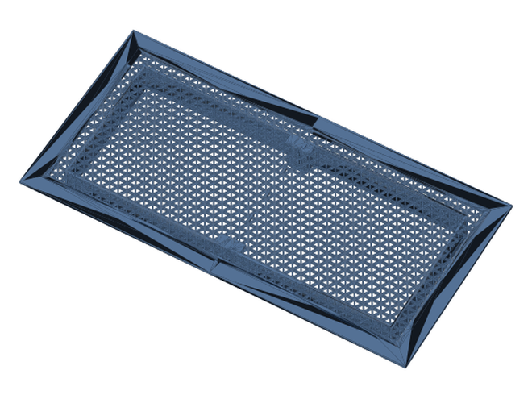

# Side Quests

Things I build outside work. By day I am a semiconductor process and materials engineer; evenings and weekends produce what's in this repo: thermodynamic screening on open materials data, materials-characterization pipelines (SEM super-resolution, impedance/DRT, a physics-rule linter for photoemission peak fits), local-first AI tooling, parametric CAD written as Python, medical-imaging pipelines, and an espresso machine that files telemetry reports.

**In a hurry?** Three artifacts carry the flavor: the [caught-and-fixed API data bug](computational-materials/mp-interface-reactions/README.md) in the materials screening, the NIIMBOT driver's [GOTCHAS.md](hardware-tools/niimbot-labelmaker/GOTCHAS.md) (identical printers, different firmware dialects), and [xpslint](advanced-materials-characterization/xpslint/README.md), a linter that audits a finished XPS peak fit and keeps derivable physics, instrument-specific measurements, and convention in three separate tiers.

Everything here shares three habits:

1. **Code over artifacts.** Parts, pipelines, and reports are all regenerable from scripts. No orphaned binaries; no personal data ships with this repo, ever.
2. **Validation as a first-class step.** Watertight checks and containment truth tables for printed parts, synthetic-data test suites for pipelines, adversarial review passes for research documents.
3. **Calibrated AI-assist notes.** All of this was built with Claude in the loop. Each project documents concretely what AI acceleration bought and where it confidently failed, because both halves are the interesting part.

> I'm a process and materials engineer by day, but everything in this repository is a personal, nights-and-weekends project. The materials-science, chemistry, and physics explorations here are pursued purely out of curiosity, on my own time and with my own equipment. Most of their methods come from my Ph.D. dissertation work or are standard, published methods of the field. They use only publicly available data and free or open source codes, and they produce only self-generated results. None of this work was done for an employer or with an employer's data, systems or equipment.

## Map

| Section | What's inside |
|---|---|
| [ai-tooling/](ai-tooling/) | Two local-first tools over your own paper library: a Zotero 7 plugin doing on-device retrieval (BM25 + ONNX embeddings) with only the most relevant passages sent to Claude, and a fully offline [Ollama](https://ollama.com/) batch summarizer that writes one structured Markdown note per PDF (its v1 notes are withdrawn: the context length was never set, so long papers were most likely cut without notice); plus a guard rail for coding agents, a queue that runs their memory-heavy jobs one at a time |
| [advanced-materials-characterization/](advanced-materials-characterization/) | Three characterization examples: SEM micrograph super-resolution (classical vs deep-learning upscaling on Apple Silicon), an EIS/DRT toolkit that deconvolves impedance spectra into relaxation-time peaks, and [xpslint](advanced-materials-characterization/xpslint/), a linter that audits finished XPS peak fits against tiered rules (physics, instrument, convention) and reports `cannot-check` when the metadata a rule needs was never declared; all run on bundled synthetic data |
| [audio/](audio/) | A construction-noise monitor born of the jackhammers next door: camera clips to a fully local dBFS timeline, noise-event detection, and an hour-bucketed report of loud minutes outside permitted hours (levels only, no speech, ever) |
| [claude-skills/](claude-skills/) | Nine working Claude Code skills: parametric CAD, academic figures, arXiv PDFs with Chain-of-Evidence citation verification, hybrid retrieval, research orchestration, transcript tooling |
| [computational-materials/](computational-materials/) | Materials Project interface-reaction screening (gate-dielectric stability, an 18-gas etch-chemistry study at 0 K vs 300 K, a caught-and-fixed API data bug), a scriptable SRIM/TRIM wrapper that drives ion-transport sputtering simulations across a parameter grid headless in Docker, and a [band-diagram kit](computational-materials/band-diagram-kit/) that draws the heterojunction band-bending figure everyone hand-draws, from an Anderson-rule construction with a built-in self-consistency check |
| [espresso-gaggiuino/](espresso-gaggiuino/) | An open-source machine mod run as a data project: 639-shot telemetry corpus, drift detection, troubleshooting as differential diagnosis |
| [hardware-tools/](hardware-tools/) | Bluetooth batch printing on macOS for a NIIMBOT label printer that ships phone-app-only: reverse-engineered BLE protocol, firmware-dialect detection, dry-run byte tracing |
| [medical-imaging/](medical-imaging/) | Two code-only studies of published imaging methods: a General Movements Assessment pose pipeline (SAM 3 on Apple Silicon) and a DICOM MRI toolkit, with caveats and shortcomings documented |
| [3d-printing/](3d-printing/) | Seventeen parametric builds plus two design playbooks; every part is a Python or OpenSCAD program |

## Highlights

 <b>pySRIM sputtering &amp; ion-transport</b> - where ions stop in an optical coating: projected range and straggle building up frame by frame (schematic; the real numbers come from TRIM in Docker)

<table>
<tr>
<td align="center" valign="middle" width="50%"></td>
<td align="center" valign="middle" width="50%"></td>
</tr>
<tr>
<td align="center" valign="top"><b>SEM super-resolution</b> classical vs deep-learning x4 synthetic sample, Apple Silicon</td>
<td align="center" valign="top"><b>EIS to DRT</b> one Nyquist arc into peaks validated on known tau</td>
</tr>
<tr>
<td align="center" valign="middle" width="50%"></td>
<td align="center" valign="middle" width="50%"></td>
</tr>
<tr>
<td align="center" valign="top"><b>Gate-dielectric screening</b> the O-Si-Ta convex hull: Ta2O5 + Si -> silicides + SiO2</td>
<td align="center" valign="top"><b>Band diagram kit</b> gate oxides vs the 1 eV offset rule SiO2, HfO2 pass; Ta2O5, TiO2 fail</td>
</tr>
<tr>
<td align="center" valign="middle" width="50%"></td>
<td align="center" valign="middle" width="50%"></td>
</tr>
<tr>
<td align="center" valign="top"><b>DICOM MRI toolkit</b> series matching and 3D review in code shown: public MNI152 template</td>
<td align="center" valign="top"><b>Kumiko lattice vent cover</b> parametric asanoha pattern bed-split with real joinery</td>
</tr>
</table>

## The projects

### [AI Tooling](ai-tooling/)

A [Zotero 7 plugin](ai-tooling/zotero-claude-assistant/) that answers questions about your own paper library from inside [Zotero](https://www.zotero.org/): a section-aware BM25 index and a quantized ONNX embedding model (e5-base-v2, 768-dim, running in a ChromeWorker via Transformers.js) retrieve on-device, Reciprocal Rank Fusion merges the rankings, and only the most relevant passages go to the Claude API. Papers never leave the machine at index time. The published 2.2.0 docs claimed more than its code did: its embedder never loaded, so hybrid search ran keyword-only; its "fully local" claim missed an ONNX Runtime CDN default for the wasm files (runtime code, not paper text); and its `[Source N]` numbers did not match the source list. 2.3.0 fixes all three in code (neither 2.3.0 nor the current 2.4.0 has run in Zotero with the real weights), and the plugin README says how an audit found them. TypeScript and esbuild; the build refuses to package an .xpi without the model weights unless you ask for a keyword-only build on purpose. Has an [ARCHITECTURE.md](ai-tooling/zotero-claude-assistant/ARCHITECTURE.md) with dataflow diagrams.

The offline sibling in this section, an [Ollama paper summarizer](ai-tooling/ollama-paper-summarizer/), takes the opposite tradeoff: it batch-summarizes a whole PDF library into structured Markdown with a local [Ollama](https://ollama.com/) model - nothing sent anywhere, no API key - so the summaries become a greppable idea bank an Obsidian similarity plugin surfaces while you write. A carefully constrained prompt keeps every note the same shape instead of a random abstract. Its README carries a correction: the v1 script never set a context length, so long papers were most likely cut without notice and the v1 notes are withdrawn; the current script sets `num_ctx` on every call and checks what the server consumed.

The [heavy job queue](ai-tooling/heavy-job-queue/) exists because two subagents of one Claude Code session once started memory-heavy model jobs in parallel on one 64 GB Mac, and it kernel-panicked. The guard already in place watched resident memory; one GPU model process showed under 1 GB of it while its real footprint was over 26 GB. The queue admits one job at a time by free memory, caps each job's whole process tree on `phys_footprint`, and remembers each job's peak for the next run; a Claude Code hook points agents at it, and it is honest that the hook is a nudge and the cap is the limit.

### [Advanced Materials Characterization](advanced-materials-characterization/)

Three example projects that look harder at a material, all running on bundled synthetic data so nothing real ships. A [SEM super-resolution tool](advanced-materials-characterization/sem-super-resolution/) batch-upscales grayscale electron-microscopy images on Apple Silicon, putting a five-model deep-learning zoo (Real-ESRGAN, SwinIR, HAT, Swin2SR, BSRGAN) next to a classical Lanczos baseline so you can decide per image whether the transformer actually resolves detail or just costs 100x more compute to look the same. Its companion, an [EIS/DRT toolkit](advanced-materials-characterization/eis-drt-toolkit/), deconvolves an electrochemical impedance spectrum into a Distribution of Relaxation Times: one blurry Nyquist arc becomes a comb of peaks along a timescale axis, so you can count how many processes are actually hiding in it. It ships headless (pyimpspec TR-RBF, CSV out) and as a Streamlit slider app, and validates itself on a synthetic Randles + two-ZARC spectrum with known time constants rather than asserting an answer. The SEM and DRT tools both document the same class of AI-assist failure caught in review: a missing import that would crash on the first run, and prototypes that hardcode a local absolute data path.

The third takes aim at a methods problem rather than an instrument. XPS peak fitting is routinely called black magic, and [xpslint](advanced-materials-characterization/xpslint/) argues the cause is specific: three epistemically different kinds of claim get written in one voice. "The Si 2p doublet has a 2:1 area ratio" is quantum mechanics; "80:20 Gaussian-Lorentzian" is a software default that became a citation; and the Shirley background is an admitted non-physical approximation that has been shown to return wrong component areas *while passing* the residual and Abbe-criterion tests you would use to check it. So the linter sorts its rules into three tiers and enforces them differently: derivable physics, when it can be checked, is an unconditional error that configuration cannot downgrade, instrument-specific quantities report **`cannot-check`** when the metadata was never declared, and conventions only ever prompt you to state your basis. `cannot-check` is the point, and it makes coverage rather than error count the headline number: how much of this fit is even checkable from what was reported. It validates itself with a synthetic forward model whose widths are derived, not hardcoded, so the negative control cannot drift away from the rule it tests. Its AI-assist lesson is the sharpest of the three: a config parser that iterated a string's characters instead of a list would have failed open, disabling nothing while reporting success. `mypy --strict` caught it, but the first fix only skipped the bad value and so still failed open. Now a config value of the wrong shape, an unknown rule code or a malformed fit file exits 2 with a one-line error, and a test pins each case.

### [Audio: Construction-Noise Monitor](audio/)

Prolonged construction next door raised one question that opinions could not settle: how loud, how often, and inside or outside working hours? A [noise monitor](audio/) answers it with data. It extracts the audio track from camera clips (ffmpeg), builds a windowed dBFS level timeline, detects noise events against a rolling-median baseline with hysteresis, renders spectrograms, and produces an hour-bucketed report flagging loud minutes outside a permitted-hours window. It is fully local (numpy, no cloud, no API keys) and processes **no speech at all** - noise levels and timing only, deliberately nowhere near what anyone said. Levels are honest relative dBFS from an uncalibrated camera microphone, not dB(A). Ships with a seeded synthetic demo so it runs without any recording.

### [Claude Code Skills](claude-skills/)

Nine of the skills that automate the rest of this repo, published as adaptable public copies: the parametric-CAD skill that built the 3d-printing section, hybrid Zotero retrieval, deep-research orchestration into Obsidian, YouTube transcript tooling, arXiv-style PDF generation, and a coupon tester whose guardrails (never purchase, never touch payment fields) are the interesting part. Skills with private local dependencies declare them honestly in marked adaptation notes.

The [arxiv-pdf](claude-skills/arxiv-pdf/) skill is where a citation-error lesson (an adversarial review pass found ten citation and framing errors in a research document) got turned into tooling. It implements the citation-relevant parts of Google Research's [Science One framework](https://research.google/blog/science-one-framework-a-verifiable-autonomous-research-framework-via-chain-of-evidence/) ([arXiv:2605.26340](https://arxiv.org/abs/2605.26340)), which separates two questions that are easy to conflate: does this reference exist, and does that paper actually say what the sentence citing it claims. The first is answered by resolving every entry against five academic APIs by DOI, arXiv ID, and title, with retracted papers and identifier-free entries treated as failures rather than skips. The second is answered by requiring a verbatim quote to occur in the source PDF, which needs no model at all - a fabricated supporting quote cannot survive a fuzzy match against the real text. The same tiering instinct that runs through this repo shows up here: `QUOTE-UNCHECKED` exists because absence from an abstract proves nothing about a paper body, and a check that could not run is not a check that passed.

### [Computational Materials](computational-materials/)

A [Materials Project interface-reaction tool](computational-materials/mp-interface-reactions/) that walks pseudo-binary mixing lines for reaction-energy kinks, MP-website style. The demo reproduces the classic gate-dielectric screening from open data: Ta2O5 decomposes against silicon into silicides + SiO2 (why it lost the high-k race) while HfO2 and Si3N4 sit at exactly 0.00 eV/atom (why they get to touch silicon). The companion study runs silicon against 18 fab gases - Bosch etch, chamber cleans, MEMS release - at 0 K and at 300 K via a SISSO-Gibbs mode, measuring exactly when the 0 K ranking stops being trustworthy and flagging where the 300 K mode itself deserves skepticism. Also documents a silently changed API default (mixed GGA/R2SCAN hull) that was corrupting results until a literature cross-check caught it.

The second tool, [pySRIM](computational-materials/pysrim-sputtering/), wraps [SRIM/TRIM](http://www.srim.org/) - the standard ion-transport Monte-Carlo, normally a click-heavy Windows GUI - so it runs headless in Docker (Wine + xvfb, `--platform linux/amd64` on Apple Silicon) across a whole parameter grid. It sputters an optical thin-film stack - low-index SiO2, high-index TiO2, and the ITO transparent conductor - and returns projected range, straggle, vacancy/damage profiles, sputter yield, and energy partitioning. The honest-notes section is the point: it says where SRIM is trustworthy (range, damage) and where it is not (absolute low-energy sputter yields), and documents the import-time monkey-patch that keeps a decade-old package alive on modern PyYAML.

The third tool, a [band-diagram kit](computational-materials/band-diagram-kit/), draws the figure every interface paper hand-draws in a vector editor: vacuum-referenced band alignment and the bent-band heterojunction at equilibrium, built from a three-line Anderson-rule construction instead of freehand. Its self-consistency invariant (the interface discontinuity must equal the electron-affinity difference, independent of doping) exists because hand-drawn versions routinely double-count the offset - and it flagged the kit's own first draft. Demos are all textbook semiconductor cases from published numbers: n-GaAs / N-AlGaAs (the modulation-doping electron transfer), Robertson's greater-than-1-eV gate-oxide offset rule (where Ta2O5 fails on band offsets just as it fails on thermodynamics one project over), and a screening-length calculator that knows when its own continuum formulas stop applying.

### [Espresso: Gaggiuino Build Research](espresso-gaggiuino/)

Replaced the controls of a [Gaggia Classic Evo Pro](https://www.gaggia-na.com/products/gaggia-classic-pro) with the open-source [Gaggiuino](https://gaggiuino.github.io/) controller (STM32 + ESP32, pressure/flow profiling, PID), then treated eight months of daily use as a data project: a 639-shot telemetry corpus pulled from the machine's HTTP API, a machine-drift analysis that isolated OPV spring fatigue from grinder and coffee variables, and troubleshooting docs structured as differential diagnoses with explicit priors. Safety claims were checked against the firmware source, not forum consensus.

### [Hardware Tools](hardware-tools/)

[Batch label printing](hardware-tools/niimbot-labelmaker/) for the [NIIMBOT D110](https://www.niimbot.com/us/hardware/detail?productCode=HPC250801095736000004), which ships with no computer software at all - phone app only, one label at a time. I liked the printer itself, but tapping labels out one at a time on a phone was never going to knock out the weekend chores: a week of food containers, a whole-pantry reorganization. This CLI takes a text file and prints the entire stack over one BLE connection. Under it sits a reverse-engineered protocol driver whose best story is in its GOTCHAS file: visually identical printers ship with different firmware dialects, and the `_M` variant returns byte-perfect success traces while printing blanks. Folder-licensed GPL-3.0 because one upstream protocol source is GPL - the one non-MIT corner of the repo, labeled as such.

### [Medical Imaging](medical-imaging/)

Two side quests that work through published imaging methods from first principles. Neither ships any real imaging or reports (each carries one explicitly labeled synthetic or public-template example), and neither is remotely a medical device.

- **[GMA video pipeline](medical-imaging/gma-video-pipeline/)**: how much of the published General Movements Assessment a 2D pose model can reproduce: segmentation masks (SAM 3 run deliberately on the Apple Silicon GPU through PyTorch's Metal/MPS backend, via a five-patch compatibility shim), pose keypoints, kinematic features from the published GMA computer-vision literature, and a deliberately honest proxy score that reports what it cannot see as NOT_COMPUTABLE rather than guessing. Its examples are a synthetic run.
- **[DICOM MRI toolkit](medical-imaging/dicom-mri-toolkit/)**: from DICOM study exports to an interactive 3D reconstruction: series matching by pulse parameters, normalized difference maps between matched series, spline-curvature shape analysis, five-sequence cross-validation, and a self-contained clickable HTML report.

Each has an `ARCHITECTURE.md` with system diagrams.

### [3D Printing as Code](3d-printing/)

Every part is a Python or OpenSCAD program; every STL is reproducible by running a script. Seventeen curated builds from a workshop of about 30, printed on a [Bambu Lab H2D](https://bambulab.com/en/h2d): a six-version rice-bowl gravity dispenser, a flush floor register whose safety constraint is an `assert` (and its wet-room and maximum-airflow descendants), a print-in-place sliding-damper register whose slider is collision-swept across its full travel, a 90-degree louver diverter designed by free-area arithmetic, a kumiko-lattice vent cover split for the bed with real joinery, and a multi-start replacement thread nut bracketed by an overnight eight-ring test matrix. Start with the [parametric design gotchas playbook](3d-printing/playbooks/parametric-design-gotchas.md): cross-project design rules, each traceable to a printed mistake.

## How this was built

Nearly everything here was pair-built with Claude Code. The per-project "AI-assisted build notes" sections are deliberately specific: the validation harnesses that AI made fast, and also the cross-sequence alignment approach that was confidently wrong and took two rewrites, the fillet that no-opped five versions, and the materials-screening hull-swap bug a human caught by distrusting a number off by an order of magnitude. The stable division of labor across every section: AI writes geometry, plumbing, and checks; the human owns physical judgment, spatial semantics, and looking at the picture.

## License

MIT for all code (see [LICENSE](LICENSE)), with one labeled exception: [hardware-tools/niimbot-labelmaker/](hardware-tools/niimbot-labelmaker/) is GPL-3.0 because part of its protocol knowledge derives from a GPL-3.0 upstream. Documentation and research notes may be quoted with attribution. One 3D printing project adapts a community concept and credits it in its README.
