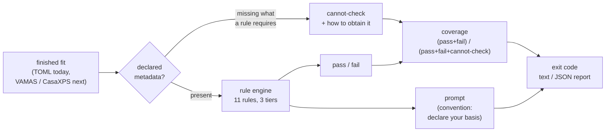

# xpslint: a physics-rule linter for XPS peak fits

X-ray photoelectron spectroscopy peak fitting has bothered me for years. Two competent
people fit the same spectrum, get different answers, both defend their choices with
citations, and neither can point at the step where the other went wrong. It gets called
black magic, usually affectionately, and the affection is how it survives.

Built on personal time and equipment, from the published literature listed in `docs/`.
Every spectrum and fit in this folder is synthetic.

It is not black magic. The actual problem is narrower and fixable: **three
epistemically different kinds of claim get written in the same voice, in the same
methods paragraph, with the same confidence.** Take a sentence you can find in hundreds
of papers:

> Spectra were charge-referenced to adventitious carbon at 284.8 eV, fitted with 80:20
> Gaussian-Lorentzian line shapes after Shirley background subtraction, constraining the
> Si 2p doublet to a 2:1 area ratio with 0.60 eV separation.

Four claims, presented identically. In reality:

- The **2:1 ratio and 0.60 eV separation** follow from quantum mechanics: they do not
  depend on the instrument or the lab, and a departure needs a named physical mechanism.
- The **Shirley background** is an admitted non-physical approximation that has been
  shown to return wrong areas while passing the residual and Abbe-criterion tests you
  would use to check it.
- The **80:20 mix** is a software default that became a citation.
- The **284.8 eV** is a number inherited from a calibration chain almost nobody invokes,
  and the recent literature has largely disqualified it for insulators.

`xpslint` sorts those apart and enforces them differently. It never fits anything. It
audits a *finished* fit, the way a linter audits code you already wrote.



## The three tiers

| Tier | What it is | How it is enforced |
|---|---|---|
| **1** | Derivable physics. Quantum mechanics, mathematics, counting statistics. | Unconditional error. Cannot be disabled or downgraded, and attempting either raises a `ConfigError` rather than being quietly ignored. A Tier 1 rule can still be `cannot-check` when the fit omits what it needs (for example ST001 without a survey); when it runs, a violation is always an error. |
| **2** | Instrument-specific and measurable. Quoted in the literature as if constant, rarely reported. | Requires declared metadata. Absent it, the answer is `cannot-check`. |
| **3** | Convention, habit, historical artifact. | Never fails. Prompts for a declaration. |

## Five outcomes, not two

`pass`, `fail`, `cannot-check`, `not-applicable`, `prompt`.

The two that matter are the two that look alike. `not-applicable` is a **complete**
answer: SO001 does not apply to an s-orbital singlet, and never will. `cannot-check` is
an **absent** one: FW001 would apply, but the instrumental width was never declared, so
nobody can evaluate it. Folding them together is tempting and wrong. On the clean
example it would report 76% coverage instead of 100%, punishing a fit for being correct.

**Coverage is the headline number:**

```
coverage = (pass + fail) / (pass + fail + cannot-check)
```

It measures the thing that makes the technique feel arbitrary in the first place: *how
much of this fit is even checkable from what was reported.* A fit with zero errors and
20% coverage has not been validated. It has been left unexamined, and now says so.

`cannot-check` alone **exits 0**. Absent metadata is a statement about the report, not a
defect in the fit, and blurring that would make the tool guilty of the same overreach it
exists to catch. `--strict` and `--min-coverage` are there for anyone wanting a hard
gate. There is deliberately **no default** for `--min-coverage`: an arbitrary threshold
would be exactly the kind of unjustified round number this project exists to remove.

### The unexpected payoff

**The `cannot-check` list is a methods-section checklist.** Every unchecked rule names
something that was not reported. Run it against your own draft and the output is,
literally, the list of disclosures the paper is missing. That may turn out to be more
useful than the pass/fail rules.

## Rules

| Code | Rule | Tier |
|---|---|---|
| SO001 | Doublet area ratio follows `2j+1` degeneracy (p 1:2, d 2:3, f 3:4) | 1 |
| SO002 | Doublet separation matches the tabulated spin-orbit splitting (`cannot-check` where the splitting depends on chemical state) | 1 |
| LS001 | Doniach-Sunjic asymmetry only where states exist at the Fermi level | 1 |
| LS002 | Every peak carries a Lorentzian term (finite core-hole lifetime) | 1 |
| LS003 | Un-truncated Doniach-Sunjic cannot be quantified (divergent integral) | 1 |
| ST001 | An assigned compound's heteroatoms must appear in the survey scan | 1 |
| FW001 | FWHM within the envelope implied by instrumental and lifetime widths | 2 |
| BG002 | Shirley used for quantification without a Tougaard cross-check | 3 |
| BG003 | Background model is declared | 3 |
| CA001 | Adventitious carbon referenced without a measured work function | 3 |
| CA002 | Charge referencing method is declared | 3 |

Two of these are worth explaining, because they are where the tier idea earns itself.

**FW001 does not use the published FWHM ranges.** Metals 0.4-1.0 eV, oxides 1.1-2.0 eV:
those envelopes are inherited heuristics from other people's spectrometers, and quoting
them as constraints is how a Tier 2 measurement gets demoted into folklore. Instead the
rule derives the floor from two genuinely knowable quantities, your **measured**
instrumental Gaussian width and the **tabulated** core-hole lifetime width, combined
through the Olivero-Longbothum Voigt approximation. Missing either one yields
`cannot-check`, never a guess.

**BG002 is Tier 3 while the residual checks are Tier 2**, which looks backwards until
you read the comparison study. Shirley backgrounds have been shown to produce completely
wrong component areas *while still yielding satisfying residual functions and Abbe
criteria*. A smooth background error absorbs into the peak areas without leaving
structured residuals, so residual and Abbe-criterion checks cannot catch it. It can only be prompted for.
Encoding that asymmetry honestly matters more than any single rule in the table.

The reasoning behind the whole tier scheme, with its numbers traced to cited sources, is in
[docs/why-tiers.md](docs/why-tiers.md). The literature survey it came from is
[docs/background-golden-rules.md](docs/background-golden-rules.md). Where it is going is
[docs/ROADMAP.md](docs/ROADMAP.md).

## Run it

Zero runtime dependencies, Python 3.11+.

```bash
pip install -e ".[dev]"          # or: uv pip install -e ".[dev]"
xpslint check examples/clean_SiO2_on_Si.toml
xpslint check examples/questionable_TiO2_Ti2p.toml
xpslint rules                    # the catalog, grouped by tier
```

Both examples are **synthetic**. Nothing real ships, and the deliberately bad one is
hand-authored: pointing this tool at a named author's published fit would be a
reputational own-goal, not a demo.

The clean fit:

```
example:SiO2-on-Si (clean)
  no findings
0 failed, 19 passed, 0 unchecked, 6 n/a, 0 prompt
coverage: 19/19 checks (100%)
```

It exits 0. The questionable one exits 1. Here it is trimmed to one finding per outcome
(the full run prints all seven failures, all three `cannot-check` lines and both prompts):

```
example:TiO2 Ti 2p (questionable)
          fail SO001  [T1] Ti2p:Ti4_1_2+Ti4_3_2
                doublet area ratio deviates from the (2j+1) multiplicity ratio
                observed: 1.709
                expected: 2.000 +/- 0.10
                hint:     departure from the statistical ratio needs a named physical mechanism, not a better residual
                cite:     (2j+1) state degeneracy; Major et al., JVST A 38, 061203 (2020)

  cannot-check FW001  [T2] Ti2p:Ti4_3_2
                requires instrument.gaussian_width
                hint:     set gaussian_width = <eV at your pass energy> in the fit file's [instrument] table; measure it on Ag 3d5/2 (clean silver) or the Fermi edge

        prompt CA001  [T3] Ti2p
                referenced to adventitious carbon at 284.8 eV without a measured work function and the calibration chain the value derives from. State the basis.
                observed: method=adventitious_carbon, value=284.8, basis=None
                expected: ISO recommends a range of 284.6 to 285.2 eV, not a point value
                cite:     Greczynski and Hultman; adventitious carbon aligns to the vacuum level

7 failed, 2 passed, 3 unchecked, 2 n/a, 2 prompt
coverage: 9/12 checks (75%)
```

And the Tier 1 guarantee is enforced, not just documented. Both runs exit 2:

```
$ cat with-SO001-disabled.toml
[tool.xpslint]
disable = ["SO001"]
$ xpslint check examples/clean_SiO2_on_Si.toml --config with-SO001-disabled.toml
xpslint: configuration error: SO001 is Tier 1 (derivable physics) and cannot be disabled. If the rule is wrong for your case, the fit needs a stated physical mechanism, not a suppressed check.
```

A config with the wrong shape fails the same way instead of being skipped. Here
`disable` is a string, not a list:

```
$ cat string-disable.toml
[tool.xpslint]
disable = "SO001"
$ xpslint check examples/clean_SiO2_on_Si.toml --config string-disable.toml
xpslint: configuration error: string-disable.toml: disable must be a list of rule codes, such as disable = ["BG002"], got 'SO001'
```

The same holds for a `severity` or `tolerances` entry that is not a table, a severity
value that is not one of `error`, `warning`, `info`, `prompt`, a tolerance that is not a
number or is out of range (negative, or an FWHM allowance below 1), a rule code that does
not exist (`disable = ["FW01"]`), and a `./pyproject.toml` that is broken: the tool exits
2 with one line on stderr and does not fall back to the defaults. A fit file is held to
the same standard: an unknown key (`gaussian_widht`), `elements = "TiO"` instead of a
list, or a number written as a string exits 2 with one line naming the field.

## Validation as a first-class step

The hard question for any validator is: **how do you know the validator is right?**
A tool that reports confident verdicts about other people's rigor had better be able to
answer that.

`src/xpslint/synth.py` is a forward model. It builds fits from ground truth you control,
and the test suite works backwards from there:

1. **Negative controls.** A valid fit must produce zero failures. For a tool whose whole
   product is trust, a false positive is the worst defect available, so this is the
   highest-priority test in the suite.
2. **Injected violations.** Perturb exactly one parameter, assert exactly one rule code
   fires. Seven of these, one per rule path.
3. **`cannot-check` coverage.** Strip the metadata and assert Tier 2 rules degrade to
   `cannot-check` rather than silently passing. This is the easiest behavior to get
   wrong and the whole point of the design.
4. **Physics invariants.** The Voigt floor exceeds both of its inputs, degenerates to
   pure Gaussian as the lifetime width vanishes and to pure Lorentzian as the instrument
   becomes ideal, and is monotonic in between.

The synthetic fit derives its own widths rather than hardcoding them: it calls
`voigt_fwhm(0.45, 0.05) * 1.3`, not `0.62`. So the negative control cannot drift out of
agreement with the rule it is testing. If the physics changes, both move together.

```
106 tests  |  96% coverage  |  ruff clean  |  mypy --strict clean  |  0 runtime deps
```

These numbers come from local runs on Python 3.11, 3.12 and 3.13 (2026-11-19). This
repository runs no CI, so nothing re-checks them on each change; run the commands below.
`mypy` checks `src/` (set in `pyproject.toml`), not the tests.

```bash
pytest --cov=xpslint --cov-report=term-missing
ruff check . && ruff format --check .
mypy
```

## Honest limitations

- **The reference data is provisional.** `src/xpslint/refdata/spin_orbit.toml` and
  `lifetimes.toml` are widely quoted values assembled during development, and each wants
  checking against a primary source (Campbell and Papp 2001 for the lifetime widths)
  before you trust a verdict built on it. Both files say so at the top. Entries that are
  absent produce `cannot-check` rather than a guessed constant, which is the same
  discipline the tool demands of its users and is why an unverified table is safe to ship
  incomplete. The questionable example declares no instrument, so FW001 reports
  `cannot-check` (requires instrument.gaussian_width). Ti 2p also has no lifetime entry
  yet, so FW001 would still be `cannot-check` after an instrument is declared.
- **One splitting per element is not enough for transition metals.** The 2p splitting of
  Ti, Fe, Ni and Cu shifts with chemical state by more than SO002's 0.05 eV tolerance
  (Ti 2p is about 5.7 eV in TiO2 and about 6.1 eV in Ti metal), so SO002 reports
  `cannot-check` for those, and for Zn as a precaution, until state-resolved values are
  tabulated.
- **The default tolerances are placeholders.** `so001_area_ratio = 0.10`,
  `so002_separation_ev = 0.05` and `fw001_broadening_allowance = 2.5` are round numbers
  chosen so the rules can run, not derived or sourced values. Set them for your own
  instrument and material.
- **A Tier 1 pass is only as strict as its tolerance.** Tier 1 rules compare against
  configurable tolerances. A config can widen them, and the report does not list changed
  tolerances, so a Tier 1 rule cannot be disabled but can be relaxed without a trace in
  the output.
- **A disabled rule is outside the coverage figure.** Disabling a Tier 2 rule removes its
  checks from both sides of the ratio, so coverage can rise. The report prints a line
  naming every rule the config disabled, so the gain is visible, but `--min-coverage`
  does not count it against you.
- **Eleven rules, not the twenty-five the roadmap lists.** Residual and Abbe-criterion
  checks (RS001-RS003), background clipping (BG001), and the remaining FWHM consistency
  rules are designed but unwritten.
- **Input is declarative TOML only.** VAMAS ISO 14976 ingest via `pynxtools-xps`, a
  CasaXPS adapter, and an lmfit `ModelResult` adapter are the next milestone. Until then
  you describe a fit by hand, which is fine for testing rules and useless for real work.
- **`--min-coverage` has no default**, so out of the box `cannot-check` never fails a
  build. That is the honest reading, but it means an undeclared fit passes trivially. The
  coverage line is printed unconditionally so a trivial pass is visibly a trivial pass.

## AI-assisted build notes

Built with Claude in the loop. Both halves are the interesting part.

**What it bought.** The scaffold was fast: package layout, the rule plugin protocol,
the text and JSON reporters, the first test suite, and a working CLI inside a single
session. Sorting the domain literature into the three tiers was genuinely
collaborative, and the specific numbers that make the argument land got pulled from
cited sources during the conversation rather than asserted: TPP-2M's own reliability
study reporting 11.0% RMS deviation and 9.2% standard uncertainty; the 284.6 versus
284.8 eV split tracing back to whether Cu 2p3/2 is set at 932.47 or 932.67 eV (from a
university XPS reference page, not a primary source); the
Shirley-vs-Tougaard finding that wrong areas can coexist with a healthy Abbe criterion.
That last one changed the design. It is why residual checks are Tier 2 and background
choice is Tier 3, and I would not have inverted them on my own.

**Where it confidently failed.**

- **It solved the wrong problem first.** The opening proposal was a polished showcase
  write-up, aimed at an audience and a purpose I did not have. I had said the motivation
  was that XPS bothers me. Plausible, well organized, and beside the point.
- **It papered over the type system rather than fixing it.** The first pass on
  `rules/spin_orbit.py` typed a helper as `list[tuple[str, object, object]]` and then
  sprinkled nine `# type: ignore[attr-defined]` comments to silence the consequences.
  `mypy --strict` rejected it. The fix was one line, a real `Pair` type alias, and it
  deleted every suppression. Suppressing a type error is the same move as suppressing a
  Tier 1 rule, which is a bad habit for this project of all projects.
- **A real latent bug: mypy caught it, the fix made it loud, and a test pins it.** Config
  parsing did `frozenset(str(c).upper() for c in raw_disable)` where `raw_disable` came
  from TOML as `object`. Write `disable = "SO001"` instead of `disable = ["SO001"]` and
  it iterates the *characters*, building a disable set of `{"S", "O", "0", "1"}` that
  matches no rule: it disables nothing and reports success. No test wrote malformed
  config; `mypy --strict` flagged the iteration over `object`. The first fix was an
  `isinstance` check that skipped any non-list value, which satisfied mypy and still
  failed open: the same string was ignored with exit 0. A later review found that, and
  now each of these wrong shapes (a non-list `disable`, a `severity` or `tolerances` section that
  is not a table, an unknown severity value) raises `ConfigError` and exits 2, with a
  test for each case in `tests/test_config.py`. A second review found two more holes of
  the same kind: an unknown rule code such as `disable = ["FW01"]` was accepted and
  disabled nothing, and the fit-file loader passed TOML straight into the data model, so
  `elements = "TiO"` became the survey {T, i, O}. Both now exit 2, with tests in
  `tests/test_review_fixes.py`.
- **The source survey it worked from is padded.** The background document carries about 50
  references and cites 26. The uncited half is provenance noise from automated
  searching, not evidence of reading. Documented at the top of that file rather than
  quietly pruned, because the padding is itself a finding about AI-assisted research.

The pattern across all four: fluent output, and the failures cluster exactly where
nothing was checking. Each one was first caught by a tool or a stated constraint, not by
reading the code and finding it unconvincing. The config bug adds the other half: a
check that goes quiet is not proof the behavior is right, so the fix is pinned by tests
that run the bad input.
