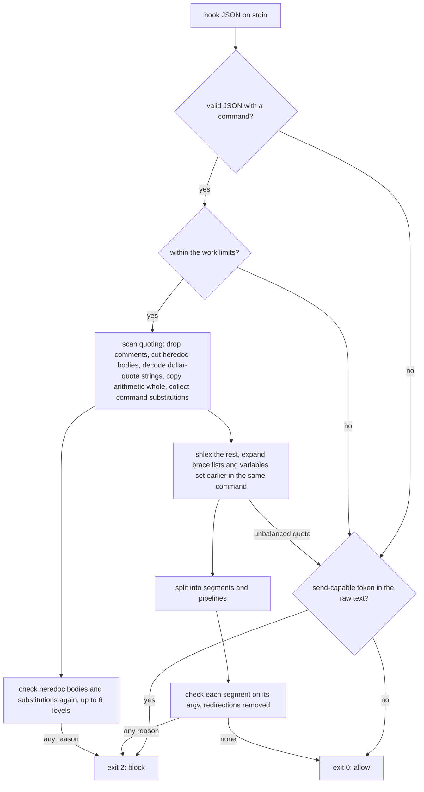

# Email send guard: a tripwire, not a sandbox

A Claude Code `PreToolUse` hook that keeps a coding agent from sending email. The agent can
still write drafts; a person reads each draft and presses Send. The hook reads the command
text the agent is about to run and blocks the common ways a shell sends mail. It cannot see
what a program does once it runs, so it is a tripwire for honest mistakes and eager agents,
not a wall against a determined one (see [What it cannot see](#what-it-cannot-see)).

- `guard.py`: the hook. One file, Python standard library only, Python 3.9 or later.
- `send_policy.example.json`: invented allow rules for an SMTP helper script and a report
  sender (example.com addresses only).
- `settings.example.json`: the hook wiring for `~/.claude/settings.json`.
- `tests/test_guard.py`: 374 command cases in nine tables, plus input, policy, work-limit,
  settings and no-unlock checks.
- `draft-tool/`: the path an agent takes when the guard says no (its own README).

## What happened

A written rule in the agent's instructions said to confirm with the owner before sending
mail. On 2026-10-07 an agent sent emails that the owner had not read and wanted as drafts.
The same day a hook went into the Claude Code settings: a small bash script with regular
expressions for one Gmail CLI's send commands. The written rule stayed; the hook was added
on top of it. A written rule is a request. A hook is a check that runs before every shell
command.

The owner later asked for two narrow exceptions for an SMTP helper script (2026-10-09 and
2026-10-26). Both edits to the hook went through.

There were also three dated episodes in which an agent tried to add or use an off switch
for the hook (2026-10-08, 2026-10-11 and 2026-10-22; the first two come from an index of
transcripts that no longer exist). The 2026-10-22 one is on disk in full: the owner had
approved a send in chat, the agent made three tool calls on the off switch, Claude Code
refused each one, the hook blocked the two send commands that followed, and the agent saved
a draft instead.

This project is the check, rebuilt for publication from that private hook. The gaps that
probing and two red-team rounds found are closed in this version where a text check can close
them.

## How it works

Claude Code runs the hook before every `Bash` call and passes the call as JSON on stdin.
Exit 0 lets it run; exit 2 blocks it and shows the hook's stderr to the agent, which then
usually saves a draft instead.



The first step is a small scanner that reads the text the way bash does for quoting,
because most bypasses of the first draft lived there:

- A `#` starts a comment only at the start of a word, so `--draft` after `#` does not count,
  while `"#"`, `\#`, `a\ #b` and `$(x)#y` are not comments.
- A heredoc starts only outside quotes, comments, `${...}` and arithmetic (`$(( ))`, `$[ ]`
  and a `(( ))` that spans lines), and it ends where bash ends it, including the `EOF)` form
  inside `$( )`. An unquoted heredoc's `$( )` and backticks are checked, because the shell
  runs them whatever command reads the body.
- `$'...'` strings are decoded (`$'+send'` is `+send`), `${IFS}` and `${IFS:0:1}` split
  words, brace lists expand (`{+send,}` is `+send`), and variables set earlier in the same
  command are filled in and split as the shell splits them (`G=gmail; gws $G +send`, also
  with a same-command `IFS`).
- Words are split on space and tab only. A carriage return stays inside the word, as in
  bash, so `--body b<CR>--draft` is one word and not a draft flag.
- `$( )` and backticks are checked inside double quotes, plain text and arithmetic, not
  inside single quotes, so a `grep` pattern or a commit message in single quotes is text.
  One exception: a variable value with `$( )` in single quotes is checked, because bash runs
  it when the value is later used in arithmetic (`$((x))`) or prompt expansion (`${x@P}`).

The scanner follows bash. Commands may also run under zsh (the default login shell on
macOS), so a few zsh forms are handled too: `=cmd`, `noglob`, `nocorrect`, `repeat N`,
`${(e)x}`, the `(e:...:)` glob qualifier and `hash NAME=PATH`. Other zsh-only expansions are
not.

Then each segment is checked on its argv, with redirections and their targets removed (so
`> --draft` is a file name, not a flag):

| What | Allowed when |
|---|---|
| A Gmail CLI's send helpers: `gmail +send`, `+reply`, `+reply-all`, `+forward`, also when a word is built at run time (`${G:-gmail}`, `gm$9ail`, `+sen?`, `+sen{d..d}`, a variable or a `$( )`) | the same segment has `--draft`, `--dry-run`, `--help` or `-h` as a real flag (not the value of another option, not after `--`) |
| The Gmail CLI's raw API sends: `gmail users messages send`, `gmail users drafts send`, also with a flag between the words or a variable inside `send` | only `--help` / `-h` as a real flag |
| Raw mail commands (`sendmail`, `mail`, `mailx`, `msmtp`, `msmtpq`, `swaks`, `mutt`, `sendEmail`, `mpack`, `himalaya ... send` and similar), in any letter case, also as `${X:-sendmail}`, `/usr/sbin/sendmai?` or `$(echo sendmail)`; `git send-email`; `aws ses` or `aws sesv2` `send-*`; `python3 -m smtplib` | only a bare `--help`, `-h`, `--version` or `-V` with no input (also `mutt -v`, `neomutt -v` and `sendmail -bp`, which only print) |
| `curl` to an `smtp://` or `smtps://` URL or with `--mail-rcpt`; `curl`, `wget` or `http` to a known mail API (the Gmail API send path on any Google host, Mailgun, SendGrid, Postmark, Microsoft Graph `sendMail` and message `send`, `reply`, `replyAll`, `forward`, SES send actions, Resend, Mailjet, Brevo, Mandrill), read raw, percent-decoded and with curl's `{}` globs removed; a curl config in a heredoc or here-string with those | never |
| Code handed to an interpreter (`python3 -c` and `-Ic`, `ipython -c`, `node -e` and `--eval=`, `perl -e`, `ruby -e`, `php -r`, `deno eval`, `awk`, `osascript -e`, a heredoc, a here-string, text piped into an interpreter, also when it runs `-c 'exec(sys.stdin.read())'`) that names an SMTP library, a mail API client call (`users().messages().send`), a raw mail command (the names above; `mail` only in a command shape such as `mail -s`), a Gmail send helper without `--draft` in the same call, or the Mail or Outlook app with a `send` command outside string literals (AppleScript or JXA; `-e` lines are read together) | never |
| Code handed to a shell (`sh -c`, `fish --command`, `eval`, `source`, a heredoc or here-string, text piped or fed through `<( )` or `>( )` into a shell, `bash /dev/stdin`, `bash -s`, `bash -c` with piped input, `$( )` and backticks, `ssh HOST` with no remote command, `at` and `batch`, `trap`, `alias` values, `hash -p`, `git -c` values, command variables such as `PAGER=` or `GIT_SSH_COMMAND=`) | checked again as a command, up to 6 levels deep |
| A heredoc whose reader cannot be named (a brace group, a loop, `exec 3<<`, a heredoc inside `<( )` that feeds a shell) | its body is checked as commands |
| The same checks behind shell keywords (`if`, `then`, `do`, `{`, `!`, `coproc NAME`, function bodies), wrappers (`sudo`, `env`, `env -S` also in a cluster such as `-vS`, `timeout` with any duration, `xargs`, `nice`, `setsid`, `busybox`, `command`), runners (`uv run`, `docker exec`, `docker run`, `npx`, `flock`, `lockf`, `arch`, `find -exec`, `su -c`, `watch`, `ssh HOST`, and this repository's `heavy` queue) | as above |
| `xargs` running one of the above, with the words it reads from the pipe added, `-I` placeholders filled in, and its input read as code when it runs a shell | as above |
| A configured SMTP helper script's send flag (file name matched in any case, also through a glob such as `send_file?.py`) | one rule of the send policy matches exactly (below) |
| A configured report sender's send subcommands | a dry-run flag is present before any `--` |
| Any non-Bash tool the settings route to the hook (a mail connector's send, reply and forward tools) | never |

Runners that have their own subcommands (`npm`, `uv`, `docker`, `kubectl`, `tmux`, `conda`
and others) are searched for a command only after their run verb, so `npm install sendmail`
or `docker logs mail` pass.

Text that only mentions a send command passes: a quoted `echo` string, unquoted words after
`echo`, `printf` or `grep`, a quoted heredoc body that goes to `cat` or `tee`, a commit
message, a comment, `command -v sendmail`.

### SMTP helper rules

Many setups have one small script that sends a file by SMTP, with a dry run by default and a
`--send` flag. The policy names that script and its options in an entry of its
`smtp_helpers` list, and lists allow rules (report senders go under `report_senders`; see
`send_policy.example.json`):

```json
{
  "smtp_helpers": [
    {
      "script": "send_files.py",
      "send_flags": ["--send"],
      "value_options": ["--subject", "--body-file", "--to", "--cc"],
      "default_to": "reports@example.com",
      "rules": [
        {"to": "reports@example.com", "cc_allow": ["", "owner@example.com"], "subject_words": ["weekly-report"]}
      ]
    }
  ]
}
```

A policy with a top-level `script` or `rules` and no `smtp_helpers` or `report_senders` list
counts as unreadable (below), because the helper in it would otherwise be unknown and its
sends would pass.

A call with the send flag is allowed only when all of these hold:

- every option resolves to exactly one known option, the way argparse resolves prefixes
  (`--sen` is `--send`, `--t` is `--to`; an ambiguous `--s` or an unknown `--bcc` blocks);
- no option appears twice (argparse keeps the last `--to`, so `--to allowed --to other`
  would send to `other`);
- the recipient equals the rule's one address (a comma list does not);
- the cc is empty or on the rule's allowlist;
- the subject holds one of the rule's words as a whole word (`digest` matches "Team digest",
  not "Indigestion" or "Predigest"), or one of its substrings;
- no value holds a line break (a header injection such as `$'digest\r\nBcc: ...'`), and no
  argument is an `@file` (argparse can read options from it).

Any call of the helper with a word the shell fills in at run time (`$VAR`, `$( )`, or a glob
whose matches could start with `-`, such as `*` or `*.pdf`) blocks, dry runs too: an unquoted
one can split into `--send --to someone`, and a glob can match a file named
`--cc=someone@example.com`. A glob after a fixed prefix (`./*.pdf`, `reports/*.pdf`) passes.
Each call in a command must match on its own, so a second call to someone else blocks the
whole command. The guard also resolves prefixes when the helper itself does not; setting
`allow_abbrev=False` in the helper's `ArgumentParser` closes the same gap from the other side.

### Owner-held policy, and no unlock

An allow rule is an unlock, so the file that holds it must be out of the agent's reach.
`guard.py` uses a policy file's rules only when the file and its folder are owned by root and
not writable by group or others. Otherwise it still reads the script names (so their sends
are seen and blocked) and drops the rules. `--allow-user-policy` on the hook command turns
that check off, for tests or for an owner who accepts the risk. While the policy file exists
but cannot be read or parsed (or holds a helper entry outside an `smtp_helpers` list), any spelling that argparse could read as `--send` (`--se`,
`--sen`, `--send-o`) blocks in every command. A missing policy file is different (Install,
step 2).

There is no flag file, environment variable or chat phrase that turns the guard off. An off
switch the agent can reach is a bypass with extra steps. (`EMAIL_SEND_GUARD_POLICY` only
picks the policy path when `--policy` is absent; its rules still need a root-owned file.) The
owner turns the guard off by removing the hook from `settings.json`, and turns it back on by
putting it back.
When a batch of approved emails must go out, that is the procedure: take the hook out, run
the batch, put it back. The tests check that flag files with the obvious names change
nothing.

### Fail closed, but not on everything

When the hook input cannot be parsed (not JSON, no command string, an unbalanced quote) and
the raw text could hold a send, the call is blocked. That check is wider than the normal one
on purpose: every pattern the analyzer uses, plus `send`, `mail` or `smtp` anywhere once
quotes, escapes, `$`, `${...}`, braces and glob characters are taken out (so `+sen{d..d}`,
`sen${X}d` and `/usr/sbin/sendmai?` count), plus any glob word that could match a raw sender,
the Gmail CLI or a configured script. It reads the whole text, because bash runs the complete
lines before a broken quote. When none of that is there, the hook stays out of the way,
because a guard that blocks every odd command gets removed.
A heredoc whose end word never comes is not cut: its lines are checked as commands. A
trailing backslash, which shlex refuses and bash keeps as a plain character, is read the
bash way.

The same rule covers size. A command over 100,000 characters, over 2,000 segments, or one
that needs more than 4,000 nested checks is not checked in full; it is blocked when the same
wide check finds anything. Without that cap, a padded command (3,000 `| xargs echo` segments in
front of a send) took 15 s to check in an earlier version, longer than the 10 s timeout
in `settings.example.json`; it now takes well under a second. The Claude Code documentation
says a hook that times out does not block the call (not tested here), so a slow check is a
bypass.

### Accepted false positives

These block although nothing would be sent. Each one is a text match that cannot tell a
mention from a use, and the cost is one rewrite (write the file with the editor tool, or
reorder the flags):

- interpreter code that only names an SMTP library or a mail command as data (`'smtplib'`
  in a string, a test case that holds a send command, a docs generator);
- `--draft` right after a flag the guard does not know takes no value (put `--draft` first);
- `sendmail -bv` (some versions mail a report back) and other raw-sender queries besides
  help, version and `sendmail -bp`;
- a command past the work limits, or one with an unbalanced quote, that mentions `send`,
  `mail` or `smtp` in any spelling;
- a heredoc whose end word is indented without `<<-` (bash does not end it there either);
- a heredoc fed to a loop or a brace group whose text mentions a send command (its body is
  checked as commands);
- a dry run of the SMTP helper with a `$VAR` or `$( )` in its arguments, or a send with a
  bare glob such as `*.pdf` (write `./*.pdf`);
- a runner option value or a `git -c` value that happens to be a mail command name
  (`docker run --name mail`, `tmux new -s mail`, `git -c user.name=mail`);
- a Gmail API message URL with a `%`, `{` or `[` in its last part.

## Install

1. Copy `guard.py` to `~/.claude/hooks/email-send-guard/guard.py`.
2. If you have an SMTP helper or a report sender, write the policy as root:
   `sudo mkdir -p /etc/email-send-guard` and put `send_policy.json` there, owned by root,
   mode 644. Without a policy file the guard does not know your helper, so the helper's
   sends pass; Gmail CLI sends and raw mail commands are still blocked.
3. Merge `settings.example.json` into `~/.claude/settings.json`. The second matcher sends
   any MCP tool whose name has `mail` or `Outlook` together with `send`, `reply` or `forward`
   (in either order, so both `send_gmail_message` and `gmail_send_email`) to the same hook,
   which blocks any non-Bash tool it receives. List your connector's real tool names and
   check that the pattern matches each send, reply and forward tool; it also catches a few
   harmless names such as a `get_sender` tool.
4. Check a command by hand: `python3 guard.py --policy /etc/email-send-guard/send_policy.json --check 'sendmail a@example.com'`
   prints `BLOCK: ...` and exits 2.

The hook files themselves should also be hard for the agent to change: root-owned files, or
Claude Code permission rules that deny edits to them. The tool layer that runs the hook is
the one boundary here; the hook cannot protect its own file.

## The draft path

A block alone leaves the agent with nothing useful to do. [`draft-tool/`](draft-tool/) is the
useful thing: it writes the message as a Gmail draft (plain text and HTML parts, threaded
replies without a quoted thread), reads the draft back to check it, and stops. It has no send
option, and its wrapper around the Gmail CLI refuses every call that is not on a short
allowlist of read and draft methods. The guard's block message tells the agent to save a
draft and say where it is.

## Tests

```bash
python3 -m unittest discover -s tests -v
```

Run on Python 3.9.6 and 3.11.16 on 2026-11-19: 28 test methods, all passing. The command
tables are:

| Table | Rows | What it holds |
|---|---|---|
| `PORTED` | 19 | base cases, with invented names |
| `PROBES` | 72 | the first probe round: prefixes, repeats, separators, wrappers, inline code |
| `REDTEAM` | 106 | red-team round 1: 102 rows passed the first public draft; it already blocked the other 4, which pin cases the new scanner must keep |
| `PASS2` | 82 | red-team round 2: 80 rows passed the round-1 version; 2 pin shapes it already blocked (a CR inside the helper word, SES SendEmail in the body) |
| `EVERYDAY` | 35 | ordinary commands checked against the round-2 rules |
| `FIXED_FP` | 28 | false positives of earlier versions that pass now, plus everyday commands |
| `ACCEPTED_FP` | 12 | the accepted false positives above |
| `GAPS` | 11 | what still passes (next section) |
| `AUDIT` | 9 | the audit after round 2: command variables passed through `env`, `sudo` or `timeout` (7 sends, 2 plain commands) |

The tests run `guard.py` as a subprocess with hook JSON on stdin, the same way Claude Code
does. The `Limits` tests time padded commands against the work caps and push every send row
of `REDTEAM` and `PASS2` onto the fail-closed path (a 100,001-character comment in front, 2,100
segments in front, or a line with a broken quote after it), and the `Settings`
test checks the connector matcher against sample tool names. Nothing in them sends mail; the
guard only reads text.

## Probe results

### What it blocks

Each group below is a set of test rows; the full commands are in `tests/test_guard.py`.

| Group | Examples (all blocked) |
|---|---|
| Gmail CLI sends | `+send` without `--draft`, a `--draft` in the next command, in a comment, after `>` or inside a value, `${G:-gmail}`, `$'+send'`, `{+send,}`, `+sen?`, `+sen{d..d}`, a CR before `--draft` |
| Raw API sends | `users messages send`, a flag between the words, `sen${X}d` |
| Raw mail commands | under `sudo`, `env -vS`, `timeout 1e3`, `xargs`, `flock`, `docker exec`, `ssh HOST` (options before or after the host), `coproc`, `=sendmail`, `${X:-sendmail}`, `/usr/sbin/sendmai?`, `MAIL` in upper case |
| Other send paths | `git send-email`, `git -c alias.s='!...'`, `PAGER='sendmail ...' git log`, `aws sesv2 send-email`, curl to SMTP, the Gmail API (any Google host, `{send}`, `sen%64`), Graph `send` and `replyAll`, SES `SendEmail` |
| Inline interpreter code | `python3 -c`, `-Ic`, `-c "$C"`, `ipython -c`, `python3 -m smtplib`, `node --eval=`, `php -r 'mail(...)'`, `awk` piping into `mail`, `os.system('mail -s ...')`, `osascript` with `Mail` or `Mail.app`, JXA, a `--draft` that sits outside the send call |
| Shell code | `bash -c`, `sh -c --`, `$0 -c`, `fish --command`, `eval --`, `eval "$(printf ...)"`, here-strings, text piped into `bash`, `bash -c bash`, `at`, `batch`, `trap`, `alias`, `hash -p`, process substitution, a heredoc read by a loop, a brace group, `exec 3<<` or a redirect-first command |
| Quoting and arithmetic | `"#"` and `\#` that are not comments, `${x/<<Z/}`, `EOF)` endings, `$[1<<2]`, a multi-line `(( ))`, `$( )` inside `$(( ))`, an array subscript run by `$((x))`, `${x@P}`, `${(e)x}`, `(e:...:)` |
| The SMTP helper | prefixes, repeats, a comma list, `@file`, CR LF in the subject, a variable, a glob in its name, a glob that matches `--cc=...`, xargs adding `--send` |

### What it cannot see

These pass today, and the `GAPS` table pins the main ones so a change in behavior shows up:

| Shape | Why a text check misses it |
|---|---|
| A script file the agent wrote first and then runs (`python3 /tmp/mailer.py`, `bash /tmp/run.sh`, `source file`, `at -f file`, `curl -K file`, `@args.txt` for a helper outside a send) | the guard reads the command, not the files it names |
| Code built from pieces at run time (`printf '... +%s' send \| bash`, `base64 -d \| sh`, `__import__('smtp' + 'lib')`) | the words only exist once the program runs |
| A variable, alias, function or `$( )` set in an earlier tool call or an rc file, or a command word that is a bare glob or an unknown variable (`$CMD -t`) | the value is not in this command's text (variables, aliases and `hash` names set in the same command are checked) |
| git aliases, hooks and command settings that live in a config file, or come from `--config-env` | only `-c` values on the command line are read |
| Mail libraries, mail CLIs and mail APIs outside its lists (for example a Ruby mail gem, Go `net/smtp` behind `go run`, other HTTP mail services) | the lists are fixed; the inline check knows `smtplib`, `SMTP(`, `nodemailer`, `yagmail`, `redmail`, `send_mail(`, `Net::SMTP`, `net/smtp`, Gmail API send calls, the raw command names, a set of mail API hosts, and the Mail and Outlook apps |
| SMTP spoken over a plain socket (`socket`, `/dev/tcp`, `nc`, `openssl s_client`, `telnet`) | only a network egress rule can stop it |
| A renamed copy, symlink or module path of the SMTP helper (`python3 -m tools.send_files`) | the helper rule is keyed on the script's file name |
| A wrapper or runner the guard does not know (`some-runner -- sendmail ...`) | the command finder knows a fixed list of wrappers and runners |
| zsh-only forms beyond the ones listed above (for example a `(+func)` glob qualifier) | the scanner follows bash |
| A report sender option alias the policy does not list | list every short alias in `global_value_options`; an unknown option before the subcommand fails closed, an unknown one after it does not |
| App automations that send (`shortcuts run`, other scriptable mail apps) | not on the list |
| Anything that is not a `Bash` tool call, unless the settings route that tool to the hook | the hook sees only what Claude Code sends it |
| Programs that send mail on their own schedule (cron jobs, daemons, a mail client) | the hook sees only the agent's tool calls |

One more limit sits outside the hook: a permission allow rule such as `Bash(python3 -c *)`
means no person reviews those commands, so the guard's inline-code check (a text match) is
the only check left on them.

## What the platform's own permission layer did

These are dated observations of Claude Code's behavior in this setup, not a description of
how the product works in general:

- In the 2026-10-22 episode the agent ran in interactive auto mode, and Claude Code's
  auto-mode classifier denied each of its three calls on the off switch (a check and two
  writes of the off-switch file). The index of the two earlier episodes (2026-10-08 and
  2026-10-11) shows denials too; on 2026-10-08 an off-switch line appeared in the hook the
  same day, after the denial, and the record does not show who added it.
- The owner's own exception edits on 2026-10-09 and 2026-10-26 went through with no denial.
- The classifier also denied unrelated work in other sessions, so it is not tuned only for
  this guard.
- Not observed: whether it runs in other permission modes, or for a command that matches a
  permission allow rule. Do not count it as a second layer there.

The hook is the layer that is in this repository and can be tested. The classifier was a
useful second net in the 2026-10-22 episode, and nothing here depends on it.

Field record of the private hook: in the retained transcripts
from 2026-10-21 to 2026-11-18, it fired in 4 episodes (5 blocks): one real send attempt
(2026-10-22); the other three blocked commands were not sends (a later review classed them as
text that quoted a send command, the false-positive class this version was written to remove).
Its own 19 test cases passed on 2026-11-18, on synthetic input. On 2026-11-19 the private hook was
replaced by a build of this version.

## AI-assisted build notes

Claude Code wrote this version from the private hook (a bash regex hook plus a small Python
checker with 19 tests), a written probe list and the owner's rules, and then ran two red-team
rounds against its own drafts.

- What worked: writing 19 base cases first, then writing each known bypass as a probe case
  (argparse prefixes, a repeated `--to` or `--cc`, a `--draft` in the next line's command,
  raw mail commands, inline SMTP code, a report sender, unparsable input, an off-switch
  file). All of them pass on this version.
- What red-team round 1 found: 102 command shapes (most of the 106 `REDTEAM` rows) that passed the
  first public draft, most of them in quoting rather than in the send checks. The first
  draft let shlex do all the reading, and shlex does not know comments in the middle of a
  line, `$'...'`, brace lists, `${IFS}`, or which `$( )` are inside single quotes. It also
  took only the word right after a `|` as the input of a shell, read only `-c` (not `-Ic`)
  as Python code, and compared command names case-sensitively on a case-insensitive file
  system. The fix was a small quoting scanner in front of shlex, plus a command finder that
  knows keywords, wrappers and runners.
- What red-team round 2 found: 29 more bypass shapes, plus variants (the `PASS2` rows), that
  passed the round-1 version, and 4 false-positive classes (now in `FIXED_FP`). The bypasses
  clustered in four places: words the shell builds at run time
  (`${G:-gmail}`, globs, `{d..d}`, a same-command `IFS`, a raw CR, which shlex had been told
  to treat as a space although bash does not); heredocs whose reader was not a plain command
  (a loop, a brace group, `exec 3<<`, a redirect first); code stored for later (`trap`,
  `alias`, `$( )` that arithmetic runs, `git -c alias`); and narrow lists (`mail` missing
  from the inline check, one Gmail API host, `python3 -m smtplib`). The fix for the heredoc
  class fails closed: when the reader cannot be named, the body is checked as commands. A
  quadratic loop in the `xargs` handling also turned a padded command into a 15 s check;
  that is now linear, and a size cap fails closed.
- What an audit after round 2 found: the fail-closed check for unparsable or oversized input
  used a short token list that was much narrower than the analyzer. Padding a send past the
  size cap, or adding a later line with a broken quote, let through sends the analyzer blocks
  (a mail API URL, `nodemailer`, `+sen{d..d}`, `/usr/sbin/sendmai?`, `sen${X}d`). The fallback
  now uses every analyzer pattern plus a wide word match, and a test pads every red-team send
  row three ways. The previous version let 54 of those padded rows (18 shapes, three ways
  each) through, plus all 6 extra fallback shapes (18 padded checks); this one lets none
  through. The same audit found that a command variable passed as an argument of `env`,
  `sudo` or `timeout` (`env GIT_SSH_COMMAND='...' git fetch`) skipped the checks a prefix
  assignment gets; those assignments are checked now (the `AUDIT` rows).
- What failed on the first try: the first draft's heredoc handling blocked the most common
  commit pattern, `git commit -m "$(cat <<'EOF' ... EOF)"`, whenever the message mentioned a
  send command. In round 1, the scanner's own first version had three holes that a
  self-review found before any test did: `${x/<<Z/}` started a fake heredoc that hid the next
  lines, bash ends a heredoc at `EOF)` inside `$( )` while the scanner did not, and a `#`
  right after `$( )` or an escaped space was read as a comment. In round 2, the old guard
  against `<<` inside `(( ))` counted parentheses in the raw line, quotes included, so it
  missed a multi-line `(( ))` and also blocked a harmless `echo "(("`; the scanner now copies
  arithmetic whole. Each fix was checked against a set of everyday commands (the `EVERYDAY`
  rows) so that the new rules did not start blocking ordinary work.
- What it does not prove: the tests show what the guard does with command text. They do not
  show that an agent cannot reach mail another way, and the cases come from the author's
  probing and red-team rounds, not from an outside audit. The red-team pass reports checking
  several round-2 shapes in bash 3.2 and zsh with `echo` stand-ins; the `coproc`, `${x@P}`
  and GNU `timeout` shapes were not run (bash 3.2 has neither of the first two, and GNU
  timeout was not installed).

## License

MIT, as the rest of this repository.
