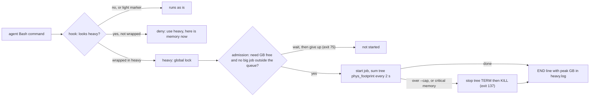

# heavy-job-queue

A one-at-a-time queue for memory-heavy jobs on a Mac, with admission by free memory, a per-job memory cap, a history of peak use, a Claude Code hook that points agents at the queue, and an optional watchdog. Python 3.9+, standard library only. The queue and the watchdog are macOS only; the hook is portable.

## The itch

In October 2026 two subagents of one Claude Code session started memory-heavy model jobs in parallel, in the background, on one 64 GB Mac, while a local LLM server kept about 27 GB resident. The machine ran out of memory and kernel-panicked: the panic report shows a watchdog timeout with the memory compressor at 100% of its segment limit.

There was a guard already. It did nothing, because it watched the wrong number. It looked for processes over 16 GB of resident memory (`ps` RSS). On a unified-memory Mac a GPU model process can show under 1 GB of RSS while its `phys_footprint` (what Activity Monitor calls "Memory", compressed pages included) is over 26 GB. So the first lesson came before any code here: measure `phys_footprint`, not RSS.

The second lesson: agents fan out by default. Telling one agent "do heavy jobs one at a time" does not stop its subagents, or a second session, from doing the same thing at the same moment. The limit has to live in one place that every job passes through.

## Design



- **One job at a time.** `heavy` takes an exclusive `flock` on one lock file. Others wait and say whom they wait for. There is no fixed order: the first waiter to retry after the lock frees wins. A job waits up to `--wait` minutes for the lock and again up to `--wait` minutes for memory before it gives up. The job inherits the lock descriptor, so the queue stays held even if the wrapper itself is killed.
- **Admission by free memory.** Before the start it waits until `--need` GB are available (`kern.memorystatus_level` x RAM) and no job process outside the queue holds `busy_gb` or more. The second check exists because the queue only knows about the jobs that use it.
- **A per-job cap.** While the job runs, `heavy` sums `phys_footprint` over the job's whole process tree (children of children count). Over `--cap` GB, or after two checks at critical memory, it stops the tree and exits 137. A cap turns "the machine panicked" into "one job failed with a clear message".
- **A history of peak use.** Every run writes START and END lines with the peak GB and minutes. With no `--need`, the next run of the same name asks for 1.2 x its past peak (at least 2 GB). `heavy --history NAME` shows the runs, so picking `--need` and `--cap` is a lookup, not a guess.
- **Nesting.** A `heavy` call inside a heavy job runs directly instead of deadlocking on the lock, but only if `HEAVY_ACTIVE` names a live ancestor of the process whose command runs `heavy`. A hand-typed `HEAVY_ACTIVE=1` goes through the queue and the cap like any other job.
- **The hook is a nudge.** `hooks/heavy_job_guard.py` is a Claude Code PreToolUse hook. It denies a Bash command that looks like a heavy job (default patterns: `--device mps|cuda`, `blender -b`, `import torch|tensorflow|transformers|mlx_lm`, `python ... *train*|*infer*|*embed*.py`) unless it runs through `heavy`, and the deny message carries the current memory and the running jobs. It reads only real commands: the first word of each segment, and the code of `python -c`, `bash -c` and heredocs; first words that never start a heavy job (`grep`, `cat`, `git`, `rm` and others) pass.

```
heavy --name embed-batch --need 12 --cap 16 -- python3 embed_corpus.py --part 3
heavy --status
heavy --history embed-batch
```

## What it does not do

- It does not enforce anything against an agent that wants around it. The hook's escape marker (`MEMGUARD_LIGHT=1` by default) is there for genuinely light commands, the agent can add it to any command, and the deny message tells it how. The real limits are the admission check and the cap inside `heavy`, and those apply only to jobs that run through `heavy`.
- The hook sees command text, not intent. A heavy job hidden inside `./run_everything.sh` passes. A queued command inside `$(...)` is still denied (kept as a known-gap test). Writing test data that contains `--device mps` in a heredoc to `python3 -` is denied too; that happened while this folder's own tests were being written.
- It does not limit GPU memory separately. On a unified-memory Mac, GPU memory is part of `phys_footprint`, which is why the cap works there; that is not true on a discrete-GPU machine.
- Other users' processes are shown by RSS in `--status` but never counted for admission or stopped (libproc reads `phys_footprint` for your own processes only).
- The admission check is a snapshot. A job that is admitted at 12 GB free and then grows is caught by its cap, not by admission.

## The watchdog

`mem_watchdog.py` is the safety net for everything that does not go through the queue. Every 5 s it reads the memory level, the macOS pressure level and swap, and then: stops any single job process over `single_job_cap_gb` (36 GB by default); after two critical checks in a row stops the largest job process of 3 GB or more (with a cool-down); and sends a warning, at most every 30 minutes, when memory stays low. Alerts go to `alert_cmd`, any command you choose, with the message as its last argument; it is empty by default, so nothing is sent anywhere until you set it.

Two behaviors differ from the first version, both because of what its log showed:

- The first version skipped the whole check when `ps` timed out, which did happen under load. This version decides on the system numbers alone and, if memory is critical, alerts that the process list could not be read.
- The first version judged "critical" only by its own thresholds (8% available, or heavy swap while memory was low) and logged "ok" in a minute when macOS itself reported critical pressure with a quarter of RAM still available. With `crit_on_os_critical` (on by default) the macOS level counts too. Its thresholds and the macOS pressure level still disagree often: macOS says "warn" in many minutes where the watchdog sees nothing to do. The watchdog has never stopped a process, so its stop thresholds are untested in anger.

To run it as a LaunchAgent, render the template and load it yourself; the script prints the commands and runs none of them:

```
launchd/render_plist.sh ~/tmp/memguard
```

The plist sends its launchd logs to `~/.local/state/memguard`; if you changed `state_dir` in the config, set `MEMGUARD_STATE` to the same folder before you render.

## Field record

From late October to the 18th of November 2026 the private version of this queue logged about 7,400 runs under about 340 job names, about 3,600 of them peaking at 10 GB or more; the highest peak was 29.8 GB under the default 30 GB cap. The cap stopped 13 runs from 3 jobs: one at 26.0 GB over a 24 GB cap on the first day, one at 13.2 over 12, and 11 runs of one batch job at 10.0 to 11.0 GB over its 10 GB cap. Repeated stops of that job led to the cache fix in the lesson below; its peaks then dropped from 9.7-11.0 GB to about 7.5 GB, with no stop in the next three days. The watchdog has run continuously since late October: no process stopped, 9 low-memory warnings, and macOS reported "warn" pressure in about 23% of its logged minutes. The Mac has written no kernel panic report since the queue went in; one forced restart in late October, cause unknown, left no panic report.

## A lesson about PyTorch on MPS

A PyTorch process that runs many inputs of different shapes on the MPS backend grows its cache item by item, and the cache is not handed back on its own. In a five-item test run, calling `gc.collect()` and then `torch.mps.empty_cache()` after each item cut the peak from 8.8 to 6.9 GB, with byte-identical output. Try that before raising a cap.

## Setup

1. Put `heavy` on your PATH: `chmod +x heavy.py && ln -s "$PWD/heavy.py" ~/.local/bin/heavy`.
2. Optional: copy `config.example.json` to `~/.config/memguard/config.json` (or set `MEMGUARD_CONFIG`) and edit it. Every key is optional; `memlib.DEFAULTS` holds the rest. The default `protect_regex` covers MCP servers, the Claude Code binary and this folder's own scripts; add your own long-running services so the watchdog never counts them as jobs.
3. Wire the hook: merge `settings.example.json` into your Claude Code settings (`~/.claude/settings.json` or the project's `.claude/settings.json`) and replace `/PATH/TO` with this folder's location.
4. Optional: tell the agent in its instructions to run heavy steps through `heavy`, one owner at a time; the hook catches the cases the instructions miss.

State (the log, the queue, `current.json`, the watchdog state) lives in `~/.local/state/memguard` by default and is in `.gitignore`.

## Tests

```
python3 -m unittest discover -s tests
```

48 tests, about 1.5 s, on Python 3.9 and 3.11. No test needs real memory pressure: every read of the machine goes through a `Probe` with two methods (`system()`, `processes()`), and the tests pass a fake one. The queue tests start real child processes that sleep and are told by the fake probe that they use 26 GB, so the cap stop, the critical-memory stop, admission refusal, waiting for the lock and the rejected `HEAVY_ACTIVE=1` run end to end; the history-based `--need` and the nesting check are unit-tested. The hook tests are generic commands that must be denied or allowed, plus the known gaps kept as tests so a fix shows up as a change.

## AI-assisted build notes

Built with Claude Code, in a session that started from a kernel panic report.

- **Win: the right number, read directly.** `phys_footprint` comes from a small `ctypes` struct for `proc_pid_rusage` in `/usr/lib/libproc.dylib`, with no third-party package and no parsing of `top` output. It is the core of both the cap and the watchdog.
- **Failure: the first guard measured RSS.** The guard in place before the panic watched `ps` RSS over 16 GB. It never fired. The cause showed up only when RSS and `phys_footprint` were compared on a live model process after the panic.
- **Failure: escape hatches that were too wide.** The first version of the hook exempted any command that ran under `lockf`, for one pipeline that had its own lock, and so it exempted any lock file at all. The first `heavy` trusted any `HEAVY_ACTIVE` value, so `HEAVY_ACTIVE=1` ran a job with no queue and no cap. A `time -p` prefix hid the `heavy` wrapper and the hook denied a correctly queued command. A review pass found all three; this version drops the lock-file exemption, checks that the outer job is a live ancestor that runs `heavy`, and skips the options of prefix words. The first fix checked only for a live ancestor, which the agent's own shell always is; a later audit caught that.
- **Failure: a zombie looks alive.** While writing the tests for this public version, each cap stop took 16 s: the stopped child is a zombie until it is reaped, and `kill(pid, 0)` succeeds on a zombie, so the stop loop waited out both 8 s grace periods. The stop now reaps the direct child with `poll()`, and a test fails if a stop takes more than 5 s.
- **Friction: persistence needs a human.** The agent's own attempt to install the watchdog as a LaunchAgent was refused by Claude Code's permission check as unauthorized persistence. The watchdog ran continuously only a week later, after the human approved the install. The render script here keeps that line: it writes a plist and prints the commands, and a person runs them.
- **Calibration: the hook is noisy.** It is a regex over command text. It denies things that are not heavy (this folder's own test data among them) and passes things that are. Keeping it as a nudge whose deny message carries live memory numbers, with the real limits in `heavy`, has worked better than trying to make the regexes perfect.
