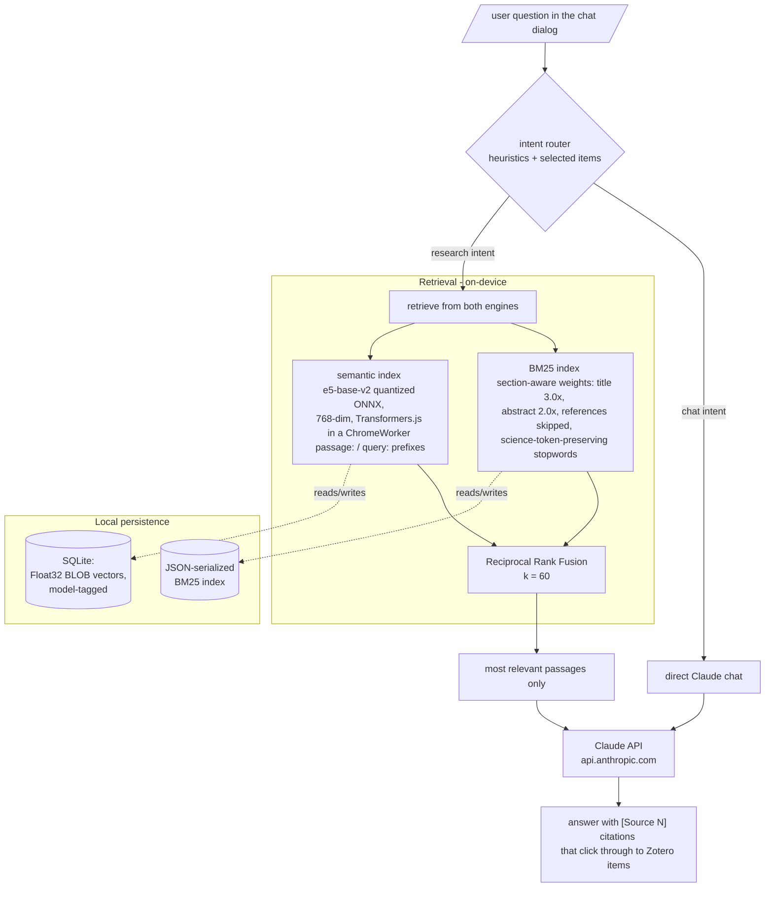
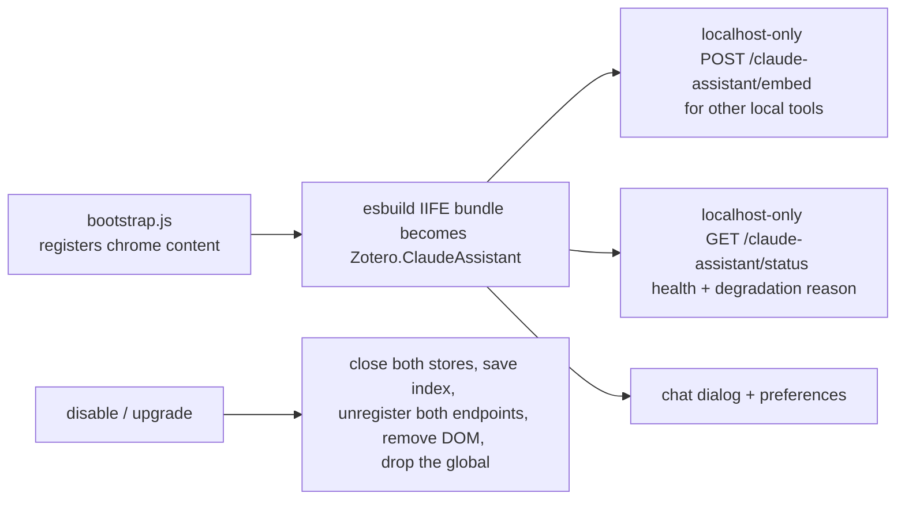

# Architecture

Structural map of the plugin. See the [section README](../README.md) for the showcase framing and the [plugin README](README.md) for install and usage.

## Query dataflow

## Plugin lifecycle

## Failure surface and observability

Added in 2.3.0 after an installed copy ran with a dead embedder and no
visible symptom. The embeddings table was empty, `/claude-assistant/embed`
answered 503, and hybrid search silently served BM25 results the whole time.

Four independent layers each "handled it gracefully", and the product of that was
an invisible outage:

| Layer | Old behavior | 2.3.0 behavior |
| --- | --- | --- |
| `scripts/build.js` | `console.warn` per missing artifact, still exits 0 | Collects missing artifacts and exits 1, unless a keyword-only build is requested deliberately (`ZCA_ALLOW_DEGRADED=1 npm run build`) |
| `scripts/fetch-model.sh` | `curl` straight to the destination path | Downloads to `.partial`, checks size and magic byte, moves into place only on success |
| `EmbeddingService.initialize()` | catch-all, sets `available = false`, logs to `Zotero.debug` | Records a typed `EmbeddingUnavailableCode` plus a human remedy, exposed via `getStatus()` |
| `/claude-assistant/embed` | `503 {"error":"Embedding service not available"}` | 503 carrying `code`, `reason`, `remedy`, and `model` |
| startup | debug line only | User-visible warning that retrieval is keyword-only, naming the fix |

Two new entry points make the state checkable without reading source:

- `GET /claude-assistant/status` returns 200 with the true state whenever the plugin is
  running (500 only on an internal error), so a caller
  can distinguish "plugin not running" (connection refused) from "plugin running,
  embedder dead" (`available: false`). A 503 alone cannot express that difference.
- `npm run doctor` checks version consistency across all five files that carry a
  version string, confirms committed assets exist, and reports which semantic
  artifacts are missing and how to get them. `npm run doctor -- --check-runtime`
  additionally probes a running Zotero. It is wired into `npm run build`.

`src/version.ts` is the single source of truth for the version. It is a separate
module because `index.ts` imports `addon.ts`, so importing the constant back from
`index.ts` would have been a cycle. `doctor.js` cross-checks it against
`package.json`, `addon/manifest.json`, `updates.json`, and `preferences.xhtml`,
which turns version drift into a build failure rather than a shipped inconsistency.

## Design decisions worth naming

- **Two engines, one fusion.** BM25 catches exact-term science queries (element symbols, units); the embedding index catches paraphrase. RRF merges them without score calibration, and if the ONNX model is unavailable everything degrades to BM25-only instead of failing.
- **Degradation is graceful but no longer silent** (changed in 2.3.0). The fallback above is still the right behavior, but until 2.3.0 it was completely invisible: a missing model file produced a `Zotero.debug` line nobody reads, a generic 503, and hybrid searches that kept returning plausible keyword-only results forever. Falling back is a runtime decision; hiding the fallback is a bug. Every layer now carries a reason code and a remedy, and the build refuses to package an .xpi that would be born in that state.
- **Model-tagged vectors.** The embedding store records which model produced its vectors and wipes them if the configured model or the stored dimension changes, so vectors from an old model are not compared against a new model's space. Since v2.4.0 the store also drops any stored vector whose byte length does not match `EMBEDDING_DIM` when it reads it (writes are not checked yet), and that constant is imported from `embedding-service` rather than duplicated, so the store cannot drift from the model that actually produces the vectors.
- **A model chosen to match an external index** (v2.4.0). The plugin embeds with `intfloat/e5-base-v2` (768-dim) rather than `bge-small-en-v1.5` (384-dim), because an external indexer (not in this repo) had embedded papers with e5 when 2.4.0 was written. Choosing the model that has data, rather than the one the plugin happened to ship, makes the query vectors from `POST /claude-assistant/embed` intended to be comparable with that store (the plugin uses the int8-quantized ONNX export; the agreement has not been measured). e5 is prefix-sensitive: documents are embedded as `passage: <text>` and queries as `query: <text>`, the same convention that external indexer uses. The prefix comes from a required `kind` argument, not a default, because getting it wrong does not error, it just retrieves worse.
- **ESM in a ChromeWorker, by force.** `importScripts()` cannot load the ESM Transformers.js bundle, so the worker fetches the bundle text, strips the export block, rewrites `import.meta.url`, and indirect-evals it into scope. Documented ugliness beats undocumented magic.
- **Network surface, and a claim that was wrong.** The 2.2.0 docs said that indexing and embedding never touch the network and that the network surface was one hostname. The code did not back that up. The worker never set ONNX Runtime's `wasmPaths`, so the runtime kept the Transformers.js default, a jsdelivr CDN URL, and the wasm files the build copied into the `.xpi` were never used. Nobody saw it happen, because the embedder never loaded at all in 2.2.0 (the model weights and runtime were missing from the build; see the CHANGELOG); the CDN fetch is inferred from the code. A pre-publish review of the privacy claims had checked call sites, found only a dead `generateEmbedding` method (since deleted), and missed this library default. Since 2.3.0 the worker pins `wasmPaths` to the vendored files and throws if the ONNX wasm backend is absent. One gap is still open: those settings run only if the worker finds the Transformers.js `env` object by name after evaluating the bundle; if a future bundle renamed it, they would be skipped without an error.
- **Where traffic goes now.** At run time the plugin calls only `api.anthropic.com`, and paper text leaves the machine only as the retrieved snippets attached to a query. Outside the plugin's own code, Zotero's updater polls the update manifest on GitHub, and `scripts/fetch-model.sh` downloads the weights from Hugging Face at build time.
