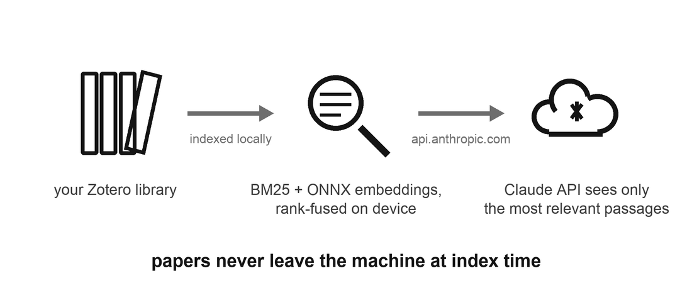

<div align="center">


# Claude Research Assistant for Zotero

**Chat with Claude or search your own Zotero library with on-device RAG, right inside Zotero.**

[](LICENSE)
[](#requirements)
[](CHANGELOG.md)

</div>

---

Claude Research Assistant is a [Zotero 7](https://www.zotero.org/) plugin that puts an AI assistant next to your library. Ask a general question and it talks to [Claude](https://www.anthropic.com/claude) directly. Ask a research question and it retrieves the most relevant passages from *your* papers first, then answers with citations back to the source items.

Retrieval runs **on your machine**. There is no Python server, no external vector database, and no cloud indexing service. Your papers are only sent to Anthropic when you actually ask a question that needs them.

> **Correction for anyone who read the 2.2.0 docs.** The 2.2.0 README promised fully local embedding, working hybrid search and correct `[Source N]` links. The 2.2.0 code delivered none of the three. The embedder never loaded, so "hybrid" search silently ran keyword-only; had it loaded, ONNX Runtime would have fetched its wasm files from a CDN; and citations were numbered in a different order than the source list the UI rendered. Version 2.3.0 fixes all three in the code (see [What has been checked](#build-from-source) for how far that was tested). The [CHANGELOG](CHANGELOG.md) has the details, and the [AI-assisted build notes](#ai-assisted-build-notes) below say how it was found.



## Highlights

- **Dual mode, automatic routing.** One chat box. The plugin detects research intent (or whether you have papers selected) and routes the query to either direct chat or RAG over your library. You can also force a mode.
- **Hybrid retrieval, local.** Combines **BM25** keyword scoring with **semantic search** using the [`e5-base-v2`](https://huggingface.co/intfloat/e5-base-v2) embedding model (768-dim) running in-browser via [Transformers.js](https://huggingface.co/docs/transformers.js). Choose `keyword`, `semantic`, or `hybrid`.
- **No backend to run.** Storage uses Zotero's own SQLite. Embeddings are computed in a Web Worker. No paper text leaves your machine during indexing (see [Privacy and data flow](#privacy-and-data-flow) for the one open gap).
- **Conversations that persist.** Chat history and the embedding index live in local SQLite databases alongside your Zotero data.
- **Pick your Claude model.** Sonnet, Opus, Haiku, and Fable are all selectable in preferences.
- **Privacy first.** Indexing and embedding are designed to run offline since 2.3.0 (one open gap and the untested status are listed under [Privacy and data flow](#privacy-and-data-flow)). No telemetry. Your API key stays in Zotero's preference store.

## How it works

```
                       ┌──────────────────────────┐
   Your question  ───▶ │   Intent router          │
                       │  (detectResearchIntent /  │
                       │   selected papers / mode) │
                       └─────────┬────────────┬────┘
                       research  │            │  chat
                                 ▼            ▼
                   ┌─────────────────┐   ┌──────────────┐
                   │  Local RAG      │   │  Direct chat │
                   │  BM25 + vector  │   │  with Claude │
                   │  over your libs │   └──────┬───────┘
                   └────────┬────────┘          │
                            │ top passages      │
                            ▼                   ▼
                   ┌──────────────────────────────────┐
                   │     Claude API (Anthropic)        │
                   │  answer + citations to your items │
                   └──────────────────────────────────┘
```

The retrieval half (`src/modules/local-rag.ts`) is a pure-TypeScript implementation: it tokenizes and chunks your items, removes stopwords, applies a domain synonym map, and scores with BM25. The semantic half (`src/modules/embedding-service.ts` plus the worker in `addon/content/scripts/embedding-worker.js`) embeds chunks and the query with `e5-base-v2` and blends the two signals for the final ranking. e5 is prefix-sensitive, so stored text is embedded as `passage: <text>` and searches as `query: <text>`.

## Installation

### Requirements

- **Zotero 7 up to 9.x.** That is the range the manifest declares (`strict_min_version` 6.999, `strict_max_version` `9.*`). The plugin has not been tested on Zotero 10, and the manifest does not claim Zotero 10 support.
- A **Claude API key** from the [Anthropic Console](https://console.anthropic.com/)
- Node.js 18.17+ only if you want to build from source (tested only on Node 26)

### Install the plugin

1. Get `claude-assistant.xpi`. No release `.xpi` is published yet, so build it from this folder's source (see [Build from source](#build-from-source) below).
2. In Zotero, open **Tools → Add-ons** (or **Tools → Plugins**).
3. Click the gear icon and choose **Install Plugin From File...**
4. Select the `.xpi` file and restart Zotero.

### Configure

1. Open **Edit → Settings → Claude Assistant** (Zotero → Settings on macOS).
2. Paste your Claude API key (it begins with `sk-ant-`).
3. Choose a model. **Sonnet 4.6** is the recommended default for cost and performance.
4. Optionally enable **query rewriting** under Search Configuration: Claude rephrases your question before retrieval for better recall, at the cost of one extra API call per research question. Chunk size and overlap for indexing are also configurable there.

## Usage

1. Open the assistant from **Tools → Ask Claude...**, or right-click an item and choose **Chat with this paper...**.
2. Type a question:
   - General questions go straight to Claude: *"Explain how BM25 differs from cosine similarity."*
   - Research questions search your library first: *"What does my library say about high-k dielectric breakdown?"*
3. To ground a conversation in specific items, select one or more papers in Zotero before asking, or right-click an item to chat about it directly.
4. Answers in research mode include citations pointing back to the source items.

### Retrieval modes

| Mode | What it uses | Best for |
|------|--------------|----------|
| `keyword` | BM25 only | Exact terms, names, formulas, acronyms |
| `semantic` | `e5-base-v2` embeddings (768-dim) | Paraphrased / conceptual queries |
| `hybrid` (default) | BM25 + embeddings blended | General use; most robust ranking |

### Claude models

Selectable in preferences:

| Model | Notes |
|-------|-------|
| **Sonnet 4.6** | Recommended. Best cost/performance. Default. |
| **Opus 4.8** | Most capable. Higher cost. |
| **Haiku 4.5** | Fastest, lowest cost. |
| **Fable 5** | Frontier, premium pricing. |
| Opus 4.7 / Opus 4.6 / Sonnet 4.5 | Also available (Sonnet 4.5 is legacy). |

## Privacy and data flow

- **Indexing and embedding run on your machine.** BM25 and the embedding model run locally; no paper text is uploaded to build the index. The worker turns off remote model downloads and points ONNX Runtime at the wasm files that the build copies into the `.xpi`; if the ONNX wasm backend is missing, it stops with an error instead of falling back to a remote fetch (`addon/content/scripts/embedding-worker.js`).
- **This claim was false in 2.2.0.** The 2.2.0 docs said "100% local", but the worker never set ONNX Runtime's `wasmPaths`, so the runtime kept the Transformers.js default, a CDN URL. In practice the embedder never loaded in 2.2.0 (the model weights and runtime were missing from the build), so search ran keyword-only; the CDN fetch is what the code would have done, inferred from the code, not observed. Fixed in 2.3.0.
- **One open gap.** The worker finds the Transformers.js `env` object by name after it evaluates the bundle. If a future Transformers.js build renamed it, the offline settings above would be skipped without an error. This is an open item, not a fix.
- **Network destinations.** At run time the plugin itself calls only `api.anthropic.com` (chat, research answers and the Settings "Test connection" button). Zotero's own updater polls this folder's `updates.json` on GitHub. `scripts/fetch-model.sh` downloads the weights from Hugging Face at build time.
- **Papers reach Anthropic only at query time**, and only the passages selected as context for the specific question you asked.
- **Your API key** is stored in Zotero's preference store, not in this repo or any external service.
- **No telemetry.** The plugin collects no usage data.
- **Local HTTP endpoints.** The plugin registers `POST /claude-assistant/embed` (so other tools on your machine can reuse the embedder) and `GET /claude-assistant/status` (health and degradation reason) on Zotero's built-in local server, which listens on localhost. Both are unregistered when the plugin is disabled.

See [SECURITY.md](SECURITY.md) for how to report vulnerabilities and how key material is handled.

## Build from source

```bash
# 1. Install dependencies
npm install

# 2. Fetch the embedding model weights (~110 MB ONNX, not committed to git)
#    Required for semantic / hybrid search. Verifies the download before
#    moving it into place.
./scripts/fetch-model.sh

# 3. Verify the tree is complete (also runs automatically as part of build)
npm run doctor

# 4. Compile TypeScript and assemble the addon
npm run build

# 5. Package into an installable .xpi (output: dist/claude-assistant.xpi)
npm run package
```

> **`npm run build` fails if semantic search would be broken.** Steps 1 and 2 are not
> optional decorations: without them the build can still assemble a working-looking `.xpi`
> in which hybrid search silently degrades to keyword-only. Since v2.3.0 the build refuses
> to do that. If you genuinely want a keyword-only plugin, opt in explicitly:
>
> ```bash
> ZCA_ALLOW_DEGRADED=1 npm run package
> ```

Useful scripts:

| Command | Action |
|---------|--------|
| `npm run doctor` | Verify versions, committed assets, and semantic-search artifacts |
| `npm run doctor -- --check-runtime` | Also probe a running Zotero and report whether the installed plugin has a live embedder |
| `npm run build` | `doctor`, then `tsc`, then assemble the addon (`scripts/build.js`) |
| `npm run watch` | Recompile TypeScript on change |
| `npm run package` | Build, then zip into a `.xpi` (`scripts/package.js`) |
| `npm run lint` | ESLint over `src/**/*.ts` |
| `npm run format` | Prettier over `src` |

**What has been checked, and where.** No CI workflow runs for this plugin yet. For 2.4.0 these steps were run by hand on macOS with Node 26 (not on GitHub, and not on the Node 18 minimum stated above):

| Step | Result |
|------|--------|
| `npm ci` | exits 0; npm lists audit advisories and skips install scripts that the build does not need |
| `npm run lint` | 0 errors, 12 warnings (unused variables) |
| `npm run build` without the ONNX weights | exits 1 and lists the missing artifact, as intended |
| `ZCA_ALLOW_DEGRADED=1 npm run build` | exits 0 with a "DEGRADED BUILD" warning |
| `node scripts/package.js` | writes `dist/claude-assistant.xpi` (keyword-only, about 5.5 MB) |

Not run for 2.4.0: a build with the real weights, and loading the `.xpi` in Zotero. There are no unit tests.

> **Note on the embedding model.** The model config and tokenizer JSON *are* committed (so the architecture is visible), but the ~110 MB quantized ONNX weight is intentionally git-ignored and downloaded by `scripts/fetch-model.sh` from [`Xenova/e5-base-v2`](https://huggingface.co/Xenova/e5-base-v2). If you package without running that script, keyword (BM25) search still works but semantic and hybrid search will be unavailable. Run `npm run doctor` at any time to see exactly which artifacts are present.

## Project structure

```
zotero-claude-assistant/
├── addon/
│   ├── manifest.json                      # Zotero plugin manifest (v2.4.0)
│   ├── bootstrap.js                       # Plugin lifecycle hooks
│   └── content/
│       ├── chat-dialog.xhtml              # Chat window UI
│       ├── preferences.xhtml / .js        # Settings UI (API key, model, mode)
│       ├── scripts/embedding-worker.js    # Web Worker running the embedder
│       ├── models/e5-base-v2/             # Model config + tokenizer (weights fetched)
│       └── icons/                         # Plugin icons
├── src/
│   ├── index.ts                           # Entry point
│   ├── version.ts                         # Single source of truth for the version
│   ├── addon.ts                           # Main addon class + smartChat router
│   ├── prefs.ts                           # Preference accessors and defaults
│   └── modules/
│       ├── claude-api.ts                  # Anthropic client + detectResearchIntent
│       ├── local-rag.ts                   # BM25 indexing/search over Zotero SQLite
│       ├── embedding-service.ts           # Embedding orchestration
│       ├── embedding-store.ts             # Vector persistence (SQLite)
│       └── conversation-store.ts          # Chat history persistence (SQLite)
├── scripts/
│   ├── build.js                           # Build/assemble script (fails on missing artifacts)
│   ├── doctor.js                          # Preflight + runtime diagnostics
│   ├── package.js                         # .xpi packaging script
│   └── fetch-model.sh                     # Download + verify ONNX embedding weights
├── updates.json                           # Zotero plugin update manifest
├── THIRD_PARTY_NOTICES.md                 # Licenses of redistributed components
└── package.json
```

## Troubleshooting

**"Claude API key not configured."** Open **Settings → Claude Assistant** and paste a key beginning with `sk-ant-`.

**Hybrid search "works" but feels shallow, and paraphrased queries miss.** This is the failure mode to actually watch for. When the embedder is dead, hybrid search does not error and does not return nothing: it silently falls back to BM25 and returns perfectly plausible keyword results forever. Check it directly rather than guessing:

```bash
# Is the installed plugin's embedder alive?
curl -s http://127.0.0.1:23119/claude-assistant/status | python3 -m json.tool

# Or, from the source tree:
npm run doctor -- --check-runtime
```

`"retrievalMode": "keyword-only"` or `"embedding": {"available": false, ...}` confirms it; `embedding.code` and `embedding.remedy` name the cause and the fix. The usual cause is that the plugin was packaged without `./scripts/fetch-model.sh` having been run, or without `npm install`, so the ONNX weights or the Transformers.js runtime never made it into the `.xpi`. Fix the tree, rebuild, and reinstall.

**`/claude-assistant/status` returns 404.** The installed plugin predates v2.3.0. Install the current build to get health reporting.

**Semantic search stopped after upgrading the plugin.** When a new version ships a different embedding model or dimension, the store discards the old vectors at startup and shows a notice; run Generate Embeddings again.

**Research mode finds 0 papers.** Make sure your library has been indexed and that the items have extractable text (encrypted or image-only PDFs will not index).

**API errors.** Confirm the key is valid and funded in the [Anthropic Console](https://console.anthropic.com/), and check your network connection.

## AI-assisted build notes

The 2.3.0 fixes came out of a code audit run with AI agents. What that showed, good and bad:

- **The build said success while the core feature was dead.** In 2.2.0 the embedder never worked. The ONNX weights are git-ignored and were never fetched, the tree had no `node_modules` so the build could not copy in the Transformers.js runtime, and each of four layers (build script, model download, service init, HTTP endpoint) handled its own failure "gracefully". The build exited 0, search kept returning plausible keyword results, and nothing told the user. Code that degrades politely at every layer adds up to an invisible outage. 2.3.0 makes the build fail and makes the state visible (`npm run doctor`, `GET /claude-assistant/status`).
- **The audit found real defects, and at least one wrong one.** A multi-agent code audit, run after the outage was found, found the CDN default behind the "100% local" claim and the `[Source N]` numbering mismatch. Both had been in the published docs as working features. It also flagged the shared model path as a doubled path that could never resolve. A later re-check against the pinned Transformers.js 3.8.1 showed that finding was wrong: 3.8.1 does not join `localModelPath` when the model id is a URL, so the old path already named the right file (checked against the library code, not in a running Zotero). The 2.3.0 split into `modelRoot` and `modelId` is kept as the clearer form, not as a fix.
- **Every finding had to survive a refutation pass.** Each candidate finding went to a separate verifier agent told to disprove it against the source. The verifier lowered the severity of 24 of the 42 findings it confirmed, so the finders overstated severity more often than not. The six it ranked most severe are addressed in 2.3.0 (one of them, the doubled model path, later proved wrong); the [CHANGELOG](CHANGELOG.md) lists them.
- **What this does not prove.** No test suite exists, and nothing in this repo records 2.4.0 running in Zotero with the real weights (see "What has been checked" above). Treat the semantic path as built and reasoned about, not field-tested. Of the 36 lower-severity audit findings, 2 are fixed in 2.4.0, 1 is superseded by the model change, 2 are only partly fixed, and 31 are still open.

## Roadmap

- [ ] Conversation management and export to Zotero notes
- [ ] Integration with Zotero's citation picker
- [ ] Configurable retrieval weights in the UI (chunking is already configurable)
- [ ] Automatic indexing of newly added items
- [ ] Additional embedding model options
- [ ] Localization

## Contributing

Contributions are welcome. Please read [CONTRIBUTING.md](CONTRIBUTING.md) and our [Code of Conduct](CODE_OF_CONDUCT.md) before opening an issue or pull request.

## License

[MIT](LICENSE) © chojay

Redistributed third-party components (the Microsoft `intfloat/e5-base-v2` model, MIT; [Transformers.js](https://github.com/huggingface/transformers.js), Apache-2.0; [ONNX Runtime Web](https://github.com/microsoft/onnxruntime), MIT) remain under their own licenses; see [THIRD_PARTY_NOTICES.md](THIRD_PARTY_NOTICES.md).

This is an independent community plugin, not affiliated with or endorsed by Anthropic or Zotero. "Claude" is a trademark of Anthropic, PBC; "Zotero" is a trademark of the Corporation for Digital Scholarship.

## Acknowledgments

- [Anthropic Claude](https://www.anthropic.com/claude) for the language model
- [Transformers.js](https://huggingface.co/docs/transformers.js) (Apache-2.0) and the [`Xenova/e5-base-v2`](https://huggingface.co/Xenova/e5-base-v2) ONNX port of Microsoft's MIT-licensed [E5](https://huggingface.co/intfloat/e5-base-v2) embedding model for on-device embeddings
- The [Zotero](https://www.zotero.org/) team and the Zotero plugin community
